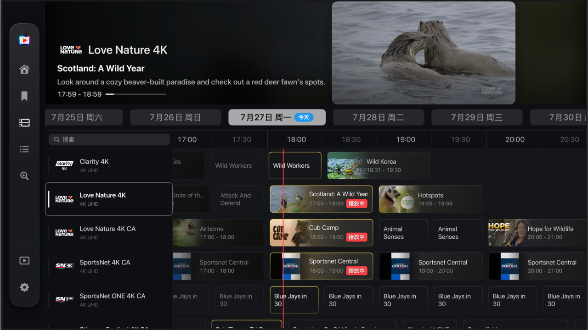

# ❓ FAQ

Answers to common questions about nanoTV features.

> 🇨🇳 [简体中文版](FAQ.zh-CN.md) · 📖 Platform guide: [nanotv.app/support.html](https://nanotv.app/support.html)

---

## 🎙️ How to enable Real-time Subtitles

1. **Initialize the model**:
   Go to **Settings → Real-time Subtitles & Translation**. First-time use requires model initialization (loading + GPU compilation, approximately 1–2 minutes). Tap **Initialize Model** and wait patiently.

2. **Enable the feature**:
   After initialization, toggle **Enable Real-time Subtitles** and pick the spoken language of your content. When it shows **On**, the feature is active.

3. **Use during playback**:
   When playing a video, swipe down (tvOS) or tap the menu button (iOS/macOS) to open the control menu. Tap the **Real-time Subtitles** button to start generation.

**Supported languages**: live transcription currently covers **English**, **Chinese (Mandarin)** and **Japanese**. To also see translated subtitles, enable Subtitle Translation as described below.

**Subtitle appearance**: in the player's subtitle settings you can choose a **frosted-glass** or **feathered (dark cloud)** background, and the font size adapts to the player window — useful on large or 4K displays.

---

## 🌐 How to enable Subtitle Translation

1. Go to **Settings → Real-time Subtitles & Translation**.

2. Tap **Enable Subtitle Translation**. A disclaimer appears on first use — confirm it to proceed.

3. Tap **Translation Service Configuration** to choose a provider. Each option must be validated before use:

   - **Google / Microsoft**: Validation depends on your network connection. Poor connectivity may cause verification to fail.
   - **Custom API**: Self-hosted service for lower latency. See [Custom Translation API](#custom-api) or the [Free Public Service](#free-service) below.
   - **DeepL / LLM**: Add your own API key for DeepL or a large language model. See [DeepL & LLM Translation](#deepl-llm) below.
   - **Apple on-device translation** *(macOS and iOS/iPadOS only)*: fast, private, and works without a network connection. It is **not available on Apple TV** — on tvOS, use DeepL, an LLM, Google, Microsoft or a custom API instead.

---

<a id="custom-api"></a>

## 🛠️ How to add a Custom Translation API

nanoTV supports self-hosted translation services compatible with the Google Translate API format, such as [MTranServer](https://github.com/xxnuo/MTranServer).

### 1. Deploy the translation service

Reference: [**MTranServer on GitHub**](https://github.com/xxnuo/MTranServer?tab=readme-ov-file)

Create a `docker-compose.yml` file:

```yaml
services:
  mtranserver:
    image: xxnuo/mtranserver:latest
    container_name: mtranserver
    restart: unless-stopped
    ports:
      - "8989:8989"
    volumes:
      - ./models:/app/models
    environment:
      # - CORE_API_TOKEN=your_token
```

Start Docker:

```bash
docker compose up -d
```

### 2. Configure nanoTV

Assuming your Docker host IP is `192.168.1.100`, go to **Settings → Real-time Subtitles & Translation → Enable Subtitle Translation → Translation Service Configuration → Custom Interface**:

- **Base URL**: `http://192.168.1.100:8989`
- **Path URL**: `/google/language/translate/v2`
- **Auth Token**: Fill in `CORE_API_TOKEN` from your `docker-compose.yml`. Leave blank if not set.

Tap **Validate**. If successful, the **Translate** button appears in the player menu — select a target language to enable real-time translation.

---

<a id="free-service"></a>

## 🆓 Is there a free public translation service?

Yes! Thanks to **Linxudo Jacopo** for providing a free community translation service. You can use it without deploying anything yourself.

**Setup**: Go to **Settings → Real-time Subtitles & Translation → Translation Service Configuration → Custom Interface** and fill in:

1. **Base URL**: `https://translate.houlang.cloud`
2. **Path URL**: Keep the default value (leave as-is)
3. **Auth Token**: Leave blank
4. Tap **Validate**. If it shows service available, you are all set.

**Source**: [linux.do community thread](https://linux.do/t/topic/1616910). This is a third-party public service; availability may vary.

---

<a id="deepl-llm"></a>

## 🤝 How to use DeepL or an LLM for translation

Alongside Google, Microsoft, Apple on-device translation (macOS and iOS only) and self-hosted APIs, nanoTV also supports **DeepL** and **large language model (LLM)** translation services. LLM translation usually reads more naturally on conversational content; DeepL is a good balance of quality and speed.

**Setup**:

1. Go to **Settings → Subtitles & Translation**.
2. Tap **Enable Subtitle Translation**, then open **Translation Service Configuration**.
3. Choose **DeepL** or the **LLM** service, fill in the API key (and model / endpoint for LLM), then tap **Validate**.
4. Once it shows service available, open the player menu during playback, tap **Translate** and pick a target language.

> **Tip**: LLM translation goes through a remote service, so response time depends on your network and the model you pick. For the lowest latency, use Apple on-device translation (macOS and iOS) or a self-hosted API on your local network.

---

## 🎞 What is 1080i 50p deinterlacing, and should I turn it on?

Many live TV channels — especially European sports and news — are broadcast as **1080i 25fps interlaced** video, which actually carries **50 fields per second**. nanoTV's **YADIF 2x** deinterlacer recognizes this and reconstructs a full **50p** double-frame-rate output, so fast motion looks much smoother instead of juddery or comb-edged.

**Enable it**: **Settings → Playback Settings → 1080i 50p Deinterlacing**. Available on macOS, iPhone, iPad and Apple TV.

**When to use it**: Turn it on for live sports and news. It costs some extra processing, so if you are on an older device and see stalls, turning it off restores the previous behaviour. Progressive sources (1080p, 4K) are unaffected.

On **Apple TV**, also enable **match frame rate and dynamic range** so tvOS outputs at the source's native frame rate (25/50/60fps) and dynamic range (SDR/HDR/HLG) — the two features together give the smoothest live sports picture.

---

## 📶 Live streams keep stalling — what can I adjust?

nanoTV lets you set the **live buffer time** in **Settings → Playback Settings**. A larger buffer absorbs network jitter and reduces stalling; a smaller buffer keeps you closer to real time. Pick the balance that fits your connection.

Other things worth trying:

1. Enable **Fast HLS Start-up** if HLS channels take too long to begin playing.
2. If a specific source has audio drifting out of sync, update to the latest version — A/V PTS mismatch on unusual sources has been fixed.
3. If a source is slow or blocked on your network, configure a **SOCKS5** or HTTP proxy in **Settings → Network Settings**.
4. Some sources only work with a particular **User-Agent** — it can be set per subscription when editing it.

---

## 🖼 How does the immersive channel preview work? (Apple TV)

On Apple TV, nanoTV plays a **live preview** of the channel you are pointing at — in the home screen hero area and in the TV Guide. You can keep watching while you look for something else, without actually switching channels.

<p align="center">
  
</p>

Previews are **muted by default** so browsing stays quiet. Swipe up into full-screen playback and the sound comes back automatically.

**Controls**: Go to **Settings → Playback Settings**, where you can separately toggle:

- Home screen channel preview
- TV Guide channel preview
- Preview sound

> Previews open a real stream connection. If your provider limits concurrent connections, or your network is constrained, turning previews off will reduce the load.

---

## ⚡ How do I play a single link, or add link-only subscriptions?

**Quick Play** lets you paste a stream URL and watch it immediately, without creating a subscription first:

- **macOS**: press <kbd>⌘N</kbd>, or use the quick entry at the bottom of the sidebar.
- **iPhone & iPad**: open it from the top-left of the home screen, or from Settings.
- **Apple TV**: open it from the bottom of the sidebar — you can scan a QR code to submit the URL from your phone instead of typing with the remote.

A **channel name** is optional; adding one makes the entry easier to recognize in your quick-play history. Any history entry can then be **saved as a subscription** in one step.

**Adding several links at once**: when adding a subscription, choose **Text Import** and paste one or more plain URLs — one per line. This is the fastest way to add single channels or link-only sources.

---

## 🔍 How do I find a channel or program quickly?

nanoTV's global search covers **channels and EPG programs across every subscription at once**, so you no longer have to open each source separately. On macOS press <kbd>⇧⌘F</kbd> to open it.

- **Fuzzy search** is the default — just type part of a name.
- **Exact match**: wrap the term in double quotes, e.g. `"CCTV5"`. Useful when a short name matches too many channels.
- **Search history**: recent searches are shown when you focus the search field, so you can repeat a lookup with one tap.
- **Results layout**: search results use an adaptive grid, and you can set how many channel cards appear per row.

---

<a id="multiple-epg"></a>

## 📺 How to configure multiple EPG sources

nanoTV supports entering multiple EPG source URLs in a single input field, separated by commas. This lets you combine program guides from different providers.

### Example

```text
https://epg1.example.com/guide.xml,https://epg2.example.com/epg.xml,https://epg3.example.com/tv.xml
```

### Tips

1. Use full `http://` or `https://` URLs for each EPG source.
2. Use **English commas** `,` as separators — **not** Chinese commas `，`.
3. Avoid adding extra spaces before or after URLs.
4. If one source is temporarily unavailable, the others will still be used — keeping guide loading successful.

Turn on **Settings → Program Guide → Update EPG when refreshing subscriptions** so the guide stays in step with your channel list. You can also refresh the EPG manually at any time.

On macOS you can **zoom the guide grid** in and out to view a wider time range or more channels at once.

---

Still stuck? Visit [nanotv.app](https://nanotv.app) or join the [Telegram Community](https://t.me/nanotvinfo).
