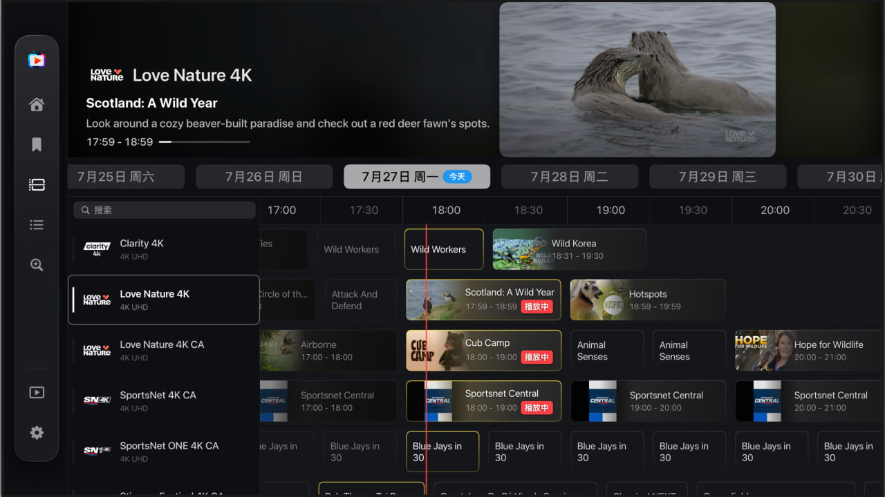

# ❓ 常见问题

关于 nanoTV 功能使用的常见问题解答。

> 🇺🇸 [English Version](FAQ.md) · 📖 各平台使用指南：[nanotv.app/support.html](https://nanotv.app/support.html)

---

## 🎙️ 如何启动实时字幕功能

1. **初始化模型**：
   进入 **设置 → 实时字幕和翻译设置**。首次启动需要初始化模型，涉及模型加载和 GPU 编译，大约 1–2 分钟。点击 **初始化模型**，耐心等待完成。

2. **启用功能**：
   初始化完成后，点击 **启用实时字幕** 按钮并选择内容的语音语言，显示 **On** 时表示已启动。

3. **播放时使用**：
   播放视频时，向下滑动（tvOS）或点击菜单按钮（iOS/macOS）打开控制菜单，点击 **实时字幕** 按钮开始生成。

**支持语言**：实时转录目前支持 **英文**、**中文（普通话）** 和 **日文**。如需同时显示翻译字幕，请按下方说明启用字幕翻译功能。

**字幕外观**：在播放窗口的字幕设置中可选择 **磨砂玻璃** 或 **羽化（暗云）** 背景效果，字幕字号还会随播放窗口自适应，在大屏或 4K 显示器上更易阅读。

---

## 🌐 如何启动字幕翻译功能

1. 进入 **设置 → 实时字幕和翻译设置**。

2. 点击 **启用字幕翻译功能** 按钮，第一次启动会有免责声明提示，确认后才能进行配置。

3. 点击 **翻译服务配置** 按钮，进入配置页面选择翻译服务。每种方式都需要验证可用后才能使用：

   - **Google / Microsoft**：验证结果取决于网络连接和速度，网络不通或速度太慢会影响验证结果。
   - **自定义接口**：本地部署，减少翻译延迟。详见下方 [自定义翻译接口](#custom-api) 和 [公益翻译服务](#free-service)。
   - **DeepL / 大模型**：填写自己的 DeepL 或大模型 API Key 即可使用，详见下方 [DeepL 与大模型翻译](#deepl-llm)。
   - **Apple 原生本地翻译** *（仅 macOS 和 iOS/iPadOS）*：速度快、私密，且无需联网。**Apple TV 暂不支持该方式**，tvOS 上请改用 DeepL、大模型、Google、Microsoft 或自定义接口。

---

<a id="custom-api"></a>

## 🛠️ 如何添加自定义翻译接口

nanoTV 支持兼容 Google Translate API 格式的自托管翻译服务，例如 [MTranServer](https://github.com/xxnuo/MTranServer)。

### 1. 部署翻译模型应用

参考：[**MTranServer on GitHub**](https://github.com/xxnuo/MTranServer?tab=readme-ov-file)

创建 `docker-compose.yml` 文件：

```yaml
services:
  mtranserver:
    image: xxnuo/mtranserver:latest
    container_name: mtranserver
    restart: unless-stopped
    ports:
      - "8989:8989"
    volumes:
      - ./models:/app/models
    environment:
      # - CORE_API_TOKEN=your_token
```

启动 Docker：

```bash
docker compose up -d
```

### 2. 配置 nanoTV

假设部署 Docker 的 IP 地址为 `192.168.1.100`，进入 **设置 → 实时字幕和翻译设置 → 启用字幕翻译功能 → 翻译服务配置 → 定制接口**：

- **Base URL**：`http://192.168.1.100:8989`
- **Path URL**：`/google/language/translate/v2`
- **认证令牌**：根据 `docker-compose.yml` 中 `CORE_API_TOKEN` 的值填写，未配置则留空。

点击 **验证** 按钮，通过后播放时菜单会显示 **翻译** 按钮，选择目标语言后即可实时翻译。

---

<a id="free-service"></a>

## 🆓 是否有公益翻译服务？

有！感谢 **Linxudo Jacopo** 提供的公益翻译服务，无需自己部署任何服务即可使用。

**接入方法**：进入 **设置 → 实时字幕和翻译设置 → 翻译服务配置 → 定制接口**，填写：

1. **Base URL**：`https://translate.houlang.cloud`
2. **Path URL**：保持默认值不变
3. **认证令牌**：留空，不需要输入
4. 点击 **验证**，如果显示服务可用，即可开始使用。

**来源**：[linux.do 社区帖子](https://linux.do/t/topic/1616910)。此为第三方公益服务，可用性可能随时变化。

---

<a id="deepl-llm"></a>

## 🤝 如何使用 DeepL 或大模型翻译

除 Google、Microsoft、Apple 原生本地翻译（仅 macOS 和 iOS）和自托管接口外，nanoTV 还支持 **DeepL** 和 **大模型（LLM）** 翻译服务。大模型翻译在对话类内容上通常更自然流畅，DeepL 则在质量与速度之间比较均衡。

**配置步骤**：

1. 进入 **设置 → 字幕和翻译**。
2. 点击 **启用字幕翻译功能**，然后进入 **翻译服务配置**。
3. 选择 **DeepL** 或 **大模型** 服务，填写 API Key（大模型还需填写模型名称 / 接口地址），然后点击 **验证**。
4. 显示服务可用后，播放时打开菜单，点击 **翻译** 并选择目标语言即可。

> **提示**：大模型翻译需要访问远程服务，响应速度取决于网络状况和所选模型。若追求最低延迟，建议使用 Apple 原生本地翻译（macOS 和 iOS），或在局域网内自托管翻译接口。

---

## 🎞 1080i 50p 反交错是什么？该不该开启？

许多直播频道——尤其是欧洲的体育和新闻频道——采用 **1080i 25fps 隔行** 方式播出，实际上每秒包含 **50 场** 画面。nanoTV 的 **YADIF 2x** 反交错可以识别这类视频，并还原为完整的 **50p** 双倍帧率输出，运动画面因此明显更流畅，也不会出现拖影和梳状锯齿。

**开启方式**：**设置 → 播放设置 → 1080i 50p 反交错**。macOS、iPhone、iPad 和 Apple TV 均支持。

**使用建议**：观看体育赛事和新闻直播时建议开启。该功能会增加一定的处理开销，如果设备较老且出现卡顿，关闭后即可恢复原有播放方式。逐行片源（1080p、4K）不受影响。

在 **Apple TV** 上，建议同时开启 **匹配帧率与动态范围**，让 tvOS 按片源原生帧率（25/50/60fps）和动态范围（SDR/HDR/HLG）输出——两项功能配合使用，体育直播画面最为流畅。

---

## 📶 直播频繁卡顿，可以怎么调整？

nanoTV 支持在 **设置 → 播放设置** 中自定义 **直播缓冲时间**。缓冲越大越能吸收网络抖动、减少卡顿；缓冲越小则越接近实时。可根据自己的网络情况选择合适的平衡点。

其他可以尝试的方法：

1. 如果 HLS 频道启播过慢，可开启 **HLS 视频流快速启动**。
2. 如果某个源出现音画不同步，请更新到最新版本——特殊播放源的音视频 PTS 不一致问题已修复。
3. 如果播放源在当前网络下速度很慢或无法访问，可在 **设置 → 网络设置** 中配置 **SOCKS5** 或 HTTP 代理。
4. 部分播放源需要特定的 **User-Agent** 才能正常播放，可在编辑订阅时按订阅单独设置。

---

## 🖼 沉浸式频道预览如何使用？（Apple TV）

在 Apple TV 上，nanoTV 会为光标所指的频道播放 **实时预览**——首页 Hero 区域和 TV Guide 中均可显示。您可以一边寻找下一个节目，一边继续观看，无需真正切台。

<p align="center">
  
</p>

预览 **默认静音**，浏览时不会被声音打扰。上滑进入全屏播放后会自动恢复声音。

**控制开关**：进入 **设置 → 播放设置**，可分别控制：

- 首页频道预览开关
- TV Guide 频道预览开关
- 预览声音开关

> 预览会真实建立播放连接。如果您的服务商限制并发连接数，或网络带宽有限，关闭预览可减轻负担。

---

## ⚡ 如何播放单个链接，或添加纯链接订阅？

**快速播放** 可以让您粘贴一个播放地址后立即观看，无需先创建订阅：

- **macOS**：按 <kbd>⌘N</kbd>，或使用侧边栏下方的快速入口。
- **iPhone 和 iPad**：从首页顶部左侧或设置页面进入。
- **Apple TV**：从侧边栏底部进入——可扫码用手机提交播放地址，无需用遥控器逐字输入。

**频道名称** 为选填，填写后在快速播放历史中更容易辨认。历史记录中的任意条目都可以 **一键添加为订阅**。

**一次添加多个链接**：添加订阅时选择 **文本导入**，直接粘贴一个或多个纯网址（每行一个）。这是添加单频道或纯链接订阅最快的方式。

---

## 🔍 如何快速找到某个频道或节目？

nanoTV 的全局搜索可 **一次性跨所有订阅搜索频道和 EPG 节目**，无需逐个打开订阅查找。在 macOS 上按 <kbd>⇧⌘F</kbd> 即可打开搜索。

- **模糊搜索** 为默认方式——输入名称的一部分即可。
- **精确查询**：用双引号包裹搜索词，例如 `"CCTV5"`。当短名称匹配到太多频道时特别有用。
- **搜索历史**：点击搜索框时会显示最近的搜索记录，可一键重复上次的查找。
- **结果布局**：搜索结果采用自适应网格布局，可自定义每行显示的频道卡片数量。

---

<a id="multiple-epg"></a>

## 📺 如何配置多个 EPG 节目单地址

nanoTV 支持在同一个 EPG 输入框中配置多个节目单地址，使用英文逗号分隔，方便聚合多个节目单来源。

### 示例

```text
https://epg1.example.com/guide.xml,https://epg2.example.com/epg.xml,https://epg3.example.com/tv.xml
```

### 使用建议

1. 每个 EPG 地址都应填写完整的 `http://` 或 `https://` 链接。
2. 分隔符请使用 **英文逗号** `,`，不要使用中文逗号 `，`。
3. 建议不要在 URL 前后添加多余的空格。
4. 如果某个节目单源暂时不可用，其他可用源仍可正常加载，提高节目单加载成功率。

在 **设置 → 节目单** 中开启「刷新订阅时更新 EPG」，可让节目单与频道列表保持同步；也可随时手动更新 EPG。

在 macOS 上，节目单网格支持 **自由缩放**，可一次查看更长时间范围或更多频道。

---

仍未解决？请访问 [nanotv.app](https://nanotv.app) 或加入 [Telegram 社区](https://t.me/nanotvinfo)。
