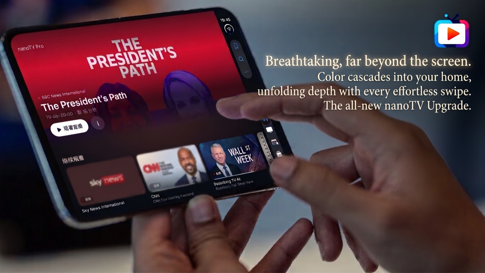
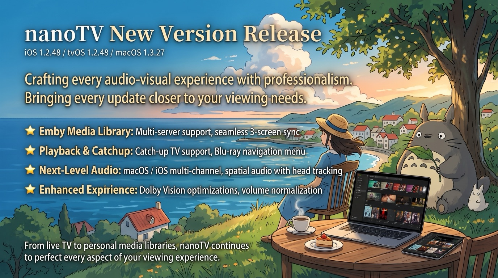

# nanoTV - Professional Media Player

  <a href="README.zh-CN.md">🇨🇳 简体中文</a>

  

  

**nanoTV** is a feature-rich, high-performance media player for **Mac, Apple TV, iPhone, and iPad**. Live TV, your own library and movies & series in one place with **Emby** and **Xtream VOD**, **split-screen live TV**, **catch-up TV**, **4K Blu-ray ISO** playback, **Dolby Vision**, **surround sound output** on Apple TV, **spatial audio with head tracking** on headphones, an AI assistant that finds channels and takes action, cross-subscription channel tags, program reminders, AI real-time subtitles in English, Chinese and Japanese, multi-engine translation, 50p deinterlacing for live sports, and 4K/8K hardware-accelerated playback.

🌐 **Website**: [nanotv.app](https://nanotv.app)

---

## ✨ Features

### 🏠 All-New Home *(iPhone, iPad)*

- **Spotlight stage**: A large view of what's on now from your recent channels, with color that flows into the page and subtle parallax as you scroll.
- **Continue Watching**: Live TV, movies and series together, most recent first.
- **Favorites**: Logo cards that play with one tap.

### 🪟 Split-Screen Live TV *(Pro)*

- **Channels**: Up to 4 at once on iPad and Apple TV, 2 on iPhone, in an even or main-and-secondary layout.
- **Sound**: One view plays sound at a time, and adding a channel doesn't interrupt the others.
- **Supported**: Live channels, including JS subscription channels. VOD and catch-up aren't supported yet.

### 📚 Emby Media Library

- **Multiple servers**: Add several Emby servers, browse and play their libraries, including .strm resources.
- **Sync everywhere**: Watch progress, favorites and recently played sync across Mac, iPhone, iPad and Apple TV.
- **Series**: The next episode plays automatically, with manual previous / next episode switching.
- **Subtitles**: Embedded subtitles, Emby server subtitles and online subtitle search.

### 🎬 Xtream VOD: Movies & Series

Live TV, movies and series on one platform. Enable it in *Settings → VOD*.

- **Poster wall & trending**: Xtream VOD metadata is scraped into a poster wall, and the week's TMDB trending titles are matched to your library.
- **Filter & search**: Filter by genre, year, country/region and language; search by title, director or cast.
- **Sync everywhere**: Watch progress, favorites and tags sync across Mac, iPhone, iPad and Apple TV via iCloud, with Trakt watch-history sync.
- **Offline viewing**: Download movies and episodes and watch without a network.
- **Subtitles**: Search OpenSubtitles, SubDL and SubSource, load local files, or use AI transcription and translation.

### ✨ AI Assistant

Not just answers — the assistant carries out the action.

- **Find and play**: Search channels, start or stop playback, query the EPG for a match or a program, and create program reminders.
- **Manage subscriptions**: Add, edit, refresh or delete **M3U / Xtream Codes / Stalker Portal** subscriptions, quick-play a network stream and save it as a subscription.
- **Organize**: Manage favorites, recently played and channel tags; adapts to your habits through personalized memory.
- **Answers nanoTV questions**: subscriptions, AI subtitles, playback settings and Pro purchases.
- **Providers**: **Google Gemini**, **NVIDIA** (free tier), **Cloudflare** (free tier) and more, with a model connection test. Enable it in *Settings → Assistant*.

### 🏷 Channel Tags

Your categories, your rules — subscription groups no longer decide how you browse.

- **Cross-subscription**: One tag can gather channels from any subscription at the same time.
- **Many tags per channel**: The same channel can live in Premier League, Sports and 4K at once.
- **Colors & symbols**: 14 system colors plus “keep original”, 29 built-in symbols and official badges for the top five football leagues.
- **Order & sync**: Drag to reorder (move up/down on tvOS), rename or restyle anytime, synced across your devices through iCloud.

### 🎯 AI Subtitles & Translation
- **AI Real-time Subtitles**: Live transcription for **English, Chinese (Mandarin) and Japanese**, with real-time translation into your language. Subtitle size adapts to the player window, with a frosted-glass or feathered background for clean, readable text.
- **Subtitle Transcript** *(iPhone, iPad, Apple TV)*: AI subtitles become a timed transcript you can read back, with the original and translation side by side.
- **ASS Styled Subtitles**: ASS subtitles keep their styling and effects.
- **Multi-engine Translation**: Choose the engine that fits you — **Apple on-device translation** (macOS and iOS), **DeepL**, **large language models (LLM)**, **Google**, **Microsoft**, or your own self-hosted API.

### 🎞 Playback Engine
- **Catch-up & Playback Speed**: Catch-up (Catchup) for live channels, and playback speed control for on-demand content.
- **Blu-ray & DVD ISO**: Play 4K Blu-ray and DVD ISO images over WebDAV or Emby, with the disc's navigation menu.
- **Dolby Vision**: Profile 5, 8.1 and 8.4 in MKV / MP4 / HLS on all three platforms, on supported devices and displays; Apple TV switches your TV into Dolby Vision mode automatically. Dual-layer Profile 7 plays as HDR10.
- **50p Deinterlacing**: YADIF 2x turns 1080i 25fps into smooth 50p — built for sports and live news, with sharper single-frame display for 1080i interlaced video.
- **Frame Rate & Dynamic Range Matching** *(Apple TV)*: Matches the output frame rate (25/50/60fps) and dynamic range (SDR/HDR/HLG) to the source.
- **Adjustable Live Buffer**: Balance stability against latency on IPTV streams.
- **Hardware Acceleration & Formats**: H.264/H.265 up to 4K and 8K, fast HLS start-up, MMTP/TLV streams, AV3A audio decoding and refined SDR color rendering.

### 🎧 Audio
- **Surround Sound Output** *(Apple TV)*: 5.1 / 7.1 output to your receiver or soundbar, with Dolby Atmos over Dolby Digital Plus and lossless TrueHD and DTS-HD MA from Blu-ray discs.
- **Multichannel & Spatial Audio** *(macOS, iOS)*: Multichannel output, with spatial audio and head tracking on headphones.
- **High-quality Audio Track**: The highest-quality audio track is picked automatically.
- **Volume Normalization**: Evens out loudness between channels and programs.

### 📺 Sources & Guide
- **Multi-format Subscriptions**: **M3U**, **Xtream Codes**, **Stalker Portal** and **TVHeadend**. Paste one or more plain URLs with **Text Import**, auto-refresh subscriptions at launch, and keep Xtream Codes groups in a sensible order.
- **Global Search**: Search channels and EPG programs across every subscription at once. Wrap a term in double quotes `""` for an exact match, and pick up where you left off with search history.
- **Electronic Program Guide (EPG)**: Zoom the guide grid in and out, browse posters and program categories, and refresh the EPG together with your subscriptions. EPG translation detects the source language and translates into the language you choose.
- **Subscription Sharing & Import**: Turn an M3U, Xtream Codes or Stalker Portal subscription into a QR code to share, and scan it on iPhone, iPad or Mac to add it in one step. nanoTV subscriptions can also be imported straight from Telegram, and the subscription name is optional.
- **Program Reminders**: Turn notifications on in *Settings → Program Guide*, then long-press a program that hasn't started yet in the guide to set a reminder — or just ask the AI assistant.
- **Remote Management & Network**: Add subscriptions from a computer or phone — including Xtream Codes, Stalker Portal and TVHeadend via QR code. SOCKS5 and HTTP proxies plus per-subscription User-Agent keep hard-to-reach sources playable.

### 🖥 Experience
- **iPhone Duo**: Playback continues as you close, open or half-fold, with table and book layouts that avoid the crease.
- **Sleep Timer** *(iOS)*: Stop playback after 15, 30, 60 or 90 minutes, or when the episode ends.
- **Immersive Channel Preview** *(Apple TV)*: The home screen hero plays the current channel live, and the TV Guide previews any channel your cursor rests on. Muted by default; sound returns when you go full screen.
- **Favorites & History**: Start from a favorite and channel switching stays inside your favorites; recent channels are one swipe away. Sort favorite channels, movies and series, and each channel remembers its subtitle and translation settings.
- **Multi-window Playback** *(macOS)*: Watch several streams at once — sound follows the active window, and AI subtitles can run in several windows.
- **Quick Play**: Paste a link and play it right away (<kbd>⌘N</kbd> on macOS), or submit a URL by QR code on Apple TV. Any quick-play entry can be saved as a subscription, and external subtitle files can be loaded.
- **iCloud Sync**: Keep subscriptions, favorites, channel tags and VOD watch progress in sync across Mac, iPhone, iPad and Apple TV, with a sync log that keeps the last 7 days.
- **Adaptive Layout & Multi-language UI**: Adaptive grids with a custom number of channel cards per row. Available in English, Simplified and Traditional Chinese, Japanese, Korean, French, Russian, Vietnamese, Arabic and more.

---

## 📥 Download

| Platform | Version | Link |
|----------|---------|------|
| **macOS** (Stable) | 1.3.27 | [Download on App Store](https://apps.apple.com/us/app/nanotv/id6754768796) |
| **iOS / iPadOS** (Stable) | 1.2.49 | [Download on App Store](https://apps.apple.com/us/app/nanotv/id6754768796) |
| **tvOS** (Stable) | 1.2.49 | [Download on App Store](https://apps.apple.com/us/app/nanotv/id6754768796) |
| **TestFlight** (Beta) | — | Temporarily unavailable |

---

## 📝 Release Notes

### Latest Release: iOS v1.2.49 · tvOS v1.2.49

  

#### 🚀 Breathtaking, Far Beyond the Screen

An all-new iOS home screen where color flows into every swipe, plus split-screen live TV, surround sound on Apple TV and a full subtitle transcript.

#### 🏠 All-New Home *(iOS)*

- 🎬 **Spotlight stage** shows what's on now from your recent channels, with channel, program and time remaining.
- ✨ Color flows into the page with subtle parallax, adapting to light and dark appearance and Reduce Motion.
- ▶️ **Continue Watching** brings live TV, movies and series together, most recent first.
- ⭐ Favorite channels appear as **logo cards** that play with one tap; channels without a logo get a text mark.
- 📐 Better layouts on iPhone, iPad, in landscape and in split view.

#### 📲 iPhone Duo

- 🔄 Playback continues as you close, open or half-fold.
- 💻 **Table mode**: the top screen plays, the bottom shows controls and the guide.
- 📖 **Book mode**: one side shows the guide, the other the video.
- 🧩 The guide and VOD poster wall resize to the screen and avoid the crease.

#### 🔊 Surround Sound Output *(tvOS)*

Turn it on in *Settings → Playback → Sound*. It replaces the Dolby Audio Output switch and keeps your setting.

- 🎬 **Dolby Atmos**: Dolby Digital Plus Atmos tracks from streams and Emby, including height channels on an Atmos receiver or soundbar. Set Apple TV's Audio Format to Auto.
- 💿 **Lossless multichannel**: Blu-ray TrueHD and DTS-HD MA output as lossless 5.1 / 7.1 PCM. TrueHD Atmos currently plays as lossless 7.1, without height channels.
- 🎼 **More formats**: DTS, FLAC and multichannel AAC also output in 5.1 / 7.1.
- 📺 **TV speakers**: The system downmixes automatically so dialogue stays clear.

#### 🪟 Split-Screen Live TV *(Pro)*

- 📺 Up to **4 channels** on iPad and Apple TV, **2** on iPhone, in an even or main-and-secondary layout.
- 🔈 One view plays sound at a time: tap to switch on iPhone / iPad, or use left and right on the Apple TV remote.
- ➕ Long-press a channel in the channel list or guide, or use the Split Screen button in the player. Channels already playing keep going.
- ℹ️ Live channels only, including JS subscription channels.

#### 📝 Subtitle Transcript *(iOS, tvOS)*

- 📖 AI subtitles become a timed transcript you can read back, with the original and translation side by side.
- 🧠 Whole sentences are re-recognized for more coherent line breaks and translation.
- 📱 **iPhone / iPad**: Bilingual, original-only or translation-only view, with copy and export.
- 📺 **Apple TV**: Turn it on under AI real-time subtitles; swipe right on the remote to read back.

#### 🛠 Improvements & Fixes

- ⏲ **Sleep timer** on iOS: 15, 30, 60 or 90 minutes, or when the episode ends.
- **Stalker**: MAC address auto-fill from the subscription link, expiry date and max connections when the source provides them, and no `ffmpeg` prefix in displayed channel links.
- **Xtream**: Subscription info shows max connections.
- Fixed Simplified Chinese translations mixing in Traditional characters.
- Fixed on-demand items sometimes staying first in Continue Watching.
- Fixed startup auto-refresh being skipped or delayed in certain cases.

---

### macOS v1.3.27 · iOS v1.2.48 · tvOS v1.2.48 — Emby Media Library

  

#### 🚀 From Live TV to Your Own Library

Crafted with care, so every update gets closer to how you watch. This release brings Emby media libraries, catch-up TV and richer Blu-ray disc playback, while macOS and iOS gain multichannel output with spatial audio and head tracking on headphones.

#### 📚 Emby Media Library

- 🗄 Add **multiple Emby servers** and browse and play their media libraries.
- ☁️ Watch progress, favorites and recently played **sync across all three platforms**.
- 📄 **.strm** resources play too.
- ⏭ Series **play the next episode automatically**, and you can switch to the previous / next episode yourself.
- 💬 Embedded subtitles, Emby server subtitles and online subtitle search.

#### ⏪ Playback & Catch-up

- 📺 **Catch-up (Catchup)** for live channels.
- ⏩ **Playback speed** control for on-demand content.
- 💿 Play **4K Blu-ray and DVD ISO** images over WebDAV or Emby, with the disc's navigation menu.
- 🔆 **Dolby Vision P5, P8.1 and P8.4** (MKV / MP4 / HLS) on all three platforms; dual-layer Blu-ray P7 plays as HDR10.
- 🎨 **ASS styled subtitles** with their effects.
- ⚡ Quick Play can load external subtitles.

#### 🎧 Audio

- 🎧 **Multichannel output** on macOS / iOS, with **spatial audio and head tracking** on headphones.
- 🎼 The highest-quality audio track is picked automatically.
- 🔊 New **volume normalization** evens out loudness between channels and programs.

#### 🛠 Improvements & Fixes

- Refined Settings layout and iOS player interface.
- Better Dolby Vision playback.
- Sharper single-frame display for 1080i interlaced video.
- Fixed accidental playback when long-pressing a channel card on iOS.
- Better channel logos on tvOS channel covers and the iOS Lock Screen artwork.
- Smarter retries for HTTP 401, 502 and similar errors.
- Improved iCloud sync, fixing a case where an old subscription could overwrite a new one.

---

📋 Previous Releases

### macOS v1.3.26 · iOS v1.2.47 · tvOS v1.2.47 — Dolby Vision

#### 🎬 Dolby Vision — Even More Brilliant Pictures

- 🌈 **Dolby Vision Profile 5, 8.1 and 8.4**, in **MKV / MP4 / HLS**.
- 🖥 Richer color and highlight detail on Dolby Vision–capable Macs, iPhones, iPads and Apple TVs with a supported display.
- 📺 **Apple TV** switches your TV into Dolby Vision mode automatically during playback.
- 💿 Dual-layer Blu-ray Dolby Vision (**Profile 7**) plays as HDR10.

#### Also in this release

- 💬 **Per-channel subtitle memory** — each channel remembers its subtitle on/off and translation language, so you don't have to set them again.
- 🔎 **Smoother VOD filtering** — finding something to watch is easier.
- 🌐 **Microsoft translation** — fixed issues with the Microsoft translation service.

---

### macOS v1.3.25 · iOS v1.2.46 · tvOS v1.2.46 — Xtream VOD

#### 🎬 From Live to VOD — nanoTV Takes a Whole New Leap

Xtream VOD brings live TV, movies and series together on one platform — one complete, unified experience across iPhone, Apple TV and Mac. Enable it in *Settings → VOD*.

- 🖼 **Poster wall** — Xtream VOD metadata is scraped automatically into a movie and series poster wall.
- 🔥 **Trending** — the week's TMDB trending movies and series, matched automatically to your Xtream VOD library.
- ⏯ **Resume playback** — progress for movies and episodes is remembered and synced across all three platforms via iCloud.
- 🔄 **Trakt** — sync your watch history with Trakt.
- 📥 **Offline** — download movies and episodes and watch them without a network.
- 💬 **Subtitles** — search online (OpenSubtitles, SubDL, SubSource), load local subtitle files, or use AI transcription and translation.
- 🔎 **Filter & search** — filter by genre, year, country/region and language; search by title, director or cast, plus global search.
- ⭐ **Favorites & tags** — favorite and tag movies and series, synced via iCloud.

#### Other new features and improvements

- 🪟 **Multi-window playback** *(macOS)* — turn on *Settings → Playback → Always play in a new window*. Sound follows the active window, and AI subtitles can run in several windows at once.
- ↕️ **Sort favorites** — for both live channels and movies & series.
- 🌐 **EPG translation** — detects the guide's source language automatically, and lets you set the target language.
- 🎞 **Frame-rate display** *(macOS, iOS)* — a more accurate readout for 60 fps and 25 fps playback.
- 🎨 **iOS interface** — a cleaner channel list with fewer divider lines, and light-mode polish with light-mode channel logos.
- 🛠 **Fixes** — tvOS search history display, channel playback from the global search page on tvOS 27, and a keyboard display issue on iOS.

### macOS v1.3.21
- ✨ **AI Assistant** — search and play channels, query the EPG, set reminders and manage subscriptions, favorites and tags. Enable it in *Settings → Assistant*.
- 🏷 **Channel Tags** — cross-subscription tags with 14 colors, 29 symbols and league badges, drag-to-reorder and iCloud sync.
- 🔗 **QR Sharing & Reminders** — share M3U / Xtream / Stalker subscriptions as a QR code, import from Telegram, and set program reminders from the guide.
- 🎞 **Playback & Compatibility** — fixes for PPV and other special sources, frame-rate info in the playback bar, better M3U parsing, more extended group formats and embedded User-Agent support.
- 💬 **AI Subtitles** — fixed subtitle timing drift on some channels.

### iOS v1.2.43 (iPhone & iPad)
- ✨ **AI Assistant** — find a channel and play it, look up programs, create reminders and manage your subscriptions by asking. Enable it in *Settings → Assistant*.
- 🏷 **Channel Tags** — build your own categories across subscriptions, synced to Mac and Apple TV via iCloud.
- 📷 **Scan to Subscribe** — scan a shared QR code to add a subscription, import from Telegram, and leave the subscription name blank if you like.
- 📂 **Open in Files** — long-press a media file in the **Files** app and play it straight in nanoTV.
- ⏰ **Program Reminders** — long-press a program that hasn't started in the guide, plus improved M3U parsing and embedded User-Agent support.

### tvOS v1.2.44 (Apple TV)
- ✨ **AI Assistant** — ask for a channel, a match or a reminder right from the big screen. Enable it in *Settings → Assistant*.
- 🏷 **Channel Tags** — the same tags as on Mac and iPhone, reordered with move up / move down on tvOS.
- 🕹 **Smoother Guide Navigation** — a better scrolling feel in the guide's channel list, and scrolling past the last channel wraps back to the first.
- 💬 **Subtitles & Formats** — fixed AI subtitle timing on some channels, with better M3U parsing, more extended group formats and embedded User-Agent support.
- ⏰ **Program Reminders** — add reminders for programs that haven't started yet from the guide.

### macOS v1.3.20
- 🗣 **Chinese & Japanese AI Subtitles** — live transcription for Mandarin and Japanese, plus Japanese translation and larger, window-adaptive subtitle sizes.
- 🔎 **Zoomable Program Guide** — zoom the EPG grid in and out, with a smarter program-matching algorithm; the guide poster area adapts its height to the window.
- 🎨 **Better Picture & Sound** — refined SDR color rendering, AV3A audio decoding, improved M3U8 parsing and fixes for A/V clock drift on certain sources.
- ⚡ **Quick Play & Home** — name your quick-play channels, and see what's on now right on favorite channel cards.
- ☁️ **iCloud** — clearer sync log that keeps the last 7 days and cleans up automatically.

### iOS v1.2.42
- 🎞 **YADIF 2x Deinterlacing** — 1080i 25fps becomes smooth 50p output. Enable it in *Settings → Playback Settings → 1080i 50p*.
- 📶 **Live Buffer Control** — set your own live buffer to balance stability against latency, plus fixes for streams with mismatched A/V PTS.
- ⭐ **Favorites That Stay Put** — start from a favorite and channel switching stays inside your favorites; new favorites entries in the guide sidebar and player.
- 📡 **AirPlay & Layout** — more reliable AirPlay playback, adaptive search grids and custom card columns.

### tvOS v1.2.43
- 🗣 **Chinese & Japanese AI Subtitles** — live transcription for Mandarin, plus Japanese transcription and translation.
- 🔊 **Dolby Audio Output** *(experimental)* — plus AV3A decoding and fixes for A/V clock drift on certain sources.
- 🎨 **SDR Color Rendering** — more natural color and picture for SDR content, with improved M3U8 parsing.
- 📋 **EPG Improvements** — better program matching, no more blank guide entries, and EPG can refresh together with subscriptions.
- 🖼 **Immersive Previews** — the home screen hero and the TV Guide play the live channel, muted by default, with sound restored in full screen.

### tvOS v1.2.42
- 🖼 **Immersive Channel Preview** — live previews on the home screen hero and in the TV Guide, with separate toggles in *Settings → Playback*.
- 🎞 **Frame Rate & Dynamic Range Matching** — Apple TV matches output to 25/50/60fps and SDR/HDR/HLG.
- ⏱ **YADIF 2x & Live Buffer** — 1080i → 50p deinterlacing and configurable live buffering.
- ⭐ **Favorites & History** — favorites context is preserved when switching channels; swipe down in the player for recently watched channels.

### macOS v1.3.19
- 🎞 **YADIF 2x & Live Buffer** — 1080i 25fps → 50p output for sports and news, plus adjustable live buffering.
- ⭐ **Favorites Context** — channel switching stays within favorites, with new entries in the guide sidebar and player.
- 🪟 **Frosted-Glass Subtitles** — new subtitle background with more depth and clearer edges.
- 🔄 **Xtream Codes Group Order** — refresh an existing subscription once to apply the new sorting.

### iOS v1.2.41
- 🎞 **YADIF 2x & Live Buffer** — smoother sports playback and configurable live buffering.
- 📡 **AirPlay** — improved playback stability.
- 🔄 **Xtream Codes Group Order** — refresh an existing subscription once to apply the improved group sorting.

### macOS v1.3.18
- 🌐 **DeepL & LLM Translation** — configure them in *Settings → Subtitles & Translation*.
- ⏩ **VOD Progress Bar** — scrub, fast-forward and rewind on-demand programs.
- 🎛 **Adaptive Grids** — set how many channel cards appear per row in subscription and favorites lists.
- 📥 **Text Import** — paste one or more plain URLs to add subscriptions in one step.

### tvOS v1.2.41
- 🌐 **DeepL & LLM Translation** — plus improved TTML subtitle parsing and display.
- 📱 **QR Code Remote Add** — scan to submit a playback URL, or add XC, Stalker Portal and TVHeadend subscriptions.
- ▶️ **Single-Click Play** — channels in the guide now play on a single click, with live program info in the top bar.

### iOS v1.2.40
- 🌐 **DeepL & LLM Translation** — configure them in *Settings → Subtitles & Translation*.
- ⚡ **Quick Play** — a new entry at the top of the home screen and in Settings, plus a VOD progress bar.
- 📥 **Text Import** — paste one or more plain URLs to add subscriptions in one step.

### macOS v1.3.17
- 🔍 **Cross-Subscription Search** — search channels and EPG programs across every subscription.
- ⚡ **Fast HLS Start-up** — enable it in Settings, and enjoy wider decoding compatibility including MMTP/TLV.
- 🔒 **SOCKS5 Proxy** — new SOCKS5 support alongside HTTP proxy.
- 🪟 **Subtitle Backgrounds** — frosted and feathered (dark cloud) subtitle backgrounds.

### iOS v1.2.38 – v1.2.39
- 🔍 **Cross-Subscription Search** — channels and EPG, with exact match via double quotes.
- 🔄 **Auto-Refresh & SOCKS5** — refresh subscriptions on launch, refresh EPG manually, and connect through SOCKS5.
- ⚡ **Fast HLS Start-up** — quicker playback start on HLS streams.

### tvOS v1.2.40
- 🔍 **Cross-Subscription Search** — channels and EPG, with exact match via double quotes.
- ⚡ **Fast HLS Start-up & SOCKS5** — quicker playback start, MMTP/TLV support and SOCKS5 proxy.
- 🪟 **Subtitle Backgrounds** — new frosted and feathered (dark cloud) subtitle backgrounds.

### macOS v1.3.13 · iOS v1.2.36 · tvOS v1.2.35
- 🔄 **Custom Subscription Ordering** — enter edit mode and drag to reorder your subscriptions.
- 🔍 **Full-Channel Search** — fuzzy matching, or wrap your term in double quotes `""` for an exact match.
- ✨ **Redesigned tvOS UI** — immersive visuals built for the big screen, with smoother navigation and a performance boost.
- ⭐ **macOS Player Controls** — added favorite and mute buttons to the playback view.

### macOS v1.3.6 · iOS v1.2.28 · tvOS v1.2.29
- 📡 **Stalker Portal Subscriptions** — add your sources via Stalker Portal.
- 📋 **EPG Download Optimization** — handles incorrect EPG file extensions.
- 🎬 **Smoother Playback** — reduced video stuttering on macOS.

### macOS v1.3.4 · iOS v1.2.26
- 🌐 **Apple Native Translation** — blazing-fast on-device subtitle translation, no internet needed. Requires iOS 18.0+.
- 📋 **EPG Window Optimization** — improved program guide browsing experience (iOS).

### macOS v1.3.3 · iOS v1.2.25 · tvOS v1.3.3
- 🔄 **iCloud Sync** — seamlessly sync subscriptions & favorites across macOS, iOS and tvOS.
- 📋 **EPG Dedicated Tab** *(iOS 18+)* — one-stop program browsing with direct channel switching, plus English ↔ Chinese EPG translation.
- ⛶ **Seamless Full-Screen** — switch channels without exiting full screen.
- 🔤 **Subtitle Font Size** — adjustable in *Settings → Playback Settings*.
- 🖼 **Home Screen Poster** *(tvOS)* — channel posters on the home screen, configurable in Settings.
- 📐 **Aspect Ratio Settings** — control video aspect ratio for any content.
- ⌨️ **Keyboard Shortcuts** *(macOS)* — full shortcut support for an efficient desktop workflow.

---

## 📖 Guides & FAQ

- [**macOS Help Document**](macOS_help.md) — quick start, AI subtitles, playback settings and keyboard shortcuts.
- [**FAQ**](FAQ.md) — real-time subtitles, translation engines, deinterlacing, buffering, EPG and more.
- [**Platform Guide (macOS / iOS / tvOS)**](https://nanotv.app/support.html) — full control and operation guide for every platform.

---

## 💬 Feedback & Support

👉 **Telegram Community**: [https://t.me/nanotvinfo](https://t.me/nanotvinfo)

We ship updates frequently and read every piece of feedback — many of the features above started as a user request in our Telegram channel.
