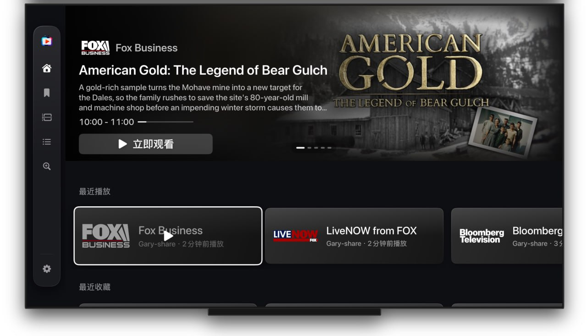

# nanoTV - Professional Media Player

  <a href="README.zh-CN.md">🇨🇳 简体中文</a>

  

  

**nanoTV** is a feature-rich, high-performance media player for **Mac, Apple TV, iPhone, and iPad**. AI real-time subtitles in English, Chinese and Japanese, multi-engine translation, 50p deinterlacing for live sports, and 4K/8K hardware-accelerated playback.

🌐 **Website**: [nanotv.app](https://nanotv.app)

---

## ✨ Features

### 🎯 AI Subtitles & Translation
- **AI Real-time Subtitles**: Live transcription for **English, Chinese (Mandarin) and Japanese**, with real-time translation into your language. Subtitle size adapts to the player window, with a frosted-glass or feathered background for clean, readable text.
- **Multi-engine Translation**: Choose the engine that fits you — **Apple on-device translation** (macOS and iOS), **DeepL**, **large language models (LLM)**, **Google**, **Microsoft**, or your own self-hosted API.

### 🎞 Playback Engine
- **50p Deinterlacing**: YADIF 2x turns 1080i 25fps into smooth 50p — built for sports and live news.
- **Frame Rate & Dynamic Range Matching** *(Apple TV)*: Matches the output frame rate (25/50/60fps) and dynamic range (SDR/HDR/HLG) to the source.
- **Adjustable Live Buffer**: Balance stability against latency on IPTV streams.
- **Hardware Acceleration & Formats**: H.264/H.265 up to 4K and 8K, fast HLS start-up, MMTP/TLV streams, AV3A audio decoding, Dolby audio output (experimental on Apple TV) and refined SDR color rendering.

### 📺 Sources & Guide
- **Multi-format Subscriptions**: **M3U**, **Xtream Codes**, **Stalker Portal** and **TVHeadend**. Paste one or more plain URLs with **Text Import**, auto-refresh subscriptions at launch, and keep Xtream Codes groups in a sensible order.
- **Global Search**: Search channels and EPG programs across every subscription at once. Wrap a term in double quotes `""` for an exact match, and pick up where you left off with search history.
- **Electronic Program Guide (EPG)**: Zoom the guide grid in and out, browse posters and program categories, and refresh the EPG together with your subscriptions.
- **Remote Management & Network**: Add subscriptions from a computer or phone — including Xtream Codes, Stalker Portal and TVHeadend via QR code. SOCKS5 and HTTP proxies plus per-subscription User-Agent keep hard-to-reach sources playable.

### 🖥 Experience
- **Immersive Channel Preview** *(Apple TV)*: The home screen hero plays the current channel live, and the TV Guide previews any channel your cursor rests on. Muted by default; sound returns when you go full screen.
- **Favorites & History**: Start from a favorite and channel switching stays inside your favorites; recent channels are one swipe away.
- **Quick Play**: Paste a link and play it right away (<kbd>⌘N</kbd> on macOS), or submit a URL by QR code on Apple TV. Any quick-play entry can be saved as a subscription.
- **iCloud Sync**: Keep subscriptions and favorites in sync across Mac, iPhone, iPad and Apple TV, with a sync log that keeps the last 7 days.
- **Adaptive Layout & Multi-language UI**: Adaptive grids with a custom number of channel cards per row. Available in English, Simplified and Traditional Chinese, Japanese, Korean, French, Russian, Vietnamese, Arabic and more.

---

## 📥 Download

| Platform | Version | Link |
|----------|---------|------|
| **macOS** (Stable) | 1.3.20 | [Download on App Store](https://apps.apple.com/us/app/nanotv/id6754768796) |
| **iOS / iPadOS** (Stable) | 1.2.42 | [Download on App Store](https://apps.apple.com/us/app/nanotv/id6754768796) |
| **tvOS** (Stable) | 1.2.43 | [Download on App Store](https://apps.apple.com/us/app/nanotv/id6754768796) |
| **TestFlight** (Beta) | — | Temporarily unavailable |

---

## 📝 Release Notes

### Latest Release: macOS v1.3.20 · iOS v1.2.42 · tvOS v1.2.43

  

#### 🆕 An Immersive Big-Screen Experience (tvOS v1.2.43)

Browsing live channels on Apple TV now feels like browsing a streaming service — the home screen and the TV Guide both play live previews, so you can keep watching while you look for what's next. Frame-rate and dynamic-range matching, 50p deinterlacing and a tunable live buffer make sports and IPTV noticeably smoother.

- 🖼 **Immersive previews** — the home screen hero and the TV Guide play the live channel, muted by default, with sound restored in full screen.
- 🎞 **Pro playback** — frame-rate & dynamic-range matching (SDR/HDR/HLG), YADIF 2x 1080i → 50p deinterlacing, and an adjustable live buffer.
- 🗣 **AI subtitles** — live transcription now covers Chinese (Mandarin) and Japanese in addition to English.

#### 🖥️ macOS v1.3.20

- 🗣 **Chinese & Japanese AI Subtitles** — live transcription for Mandarin and Japanese, plus Japanese translation and larger, window-adaptive subtitle sizes.
- 🔎 **Zoomable Program Guide** — zoom the EPG grid in and out, with a smarter program-matching algorithm; the guide poster area adapts its height to the window.
- 🎨 **Better Picture & Sound** — refined SDR color rendering, AV3A audio decoding, improved M3U8 parsing and fixes for A/V clock drift on certain sources.
- ⚡ **Quick Play & Home** — name your quick-play channels, and see what's on now right on favorite channel cards.
- ☁️ **iCloud** — clearer sync log that keeps the last 7 days and cleans up automatically.

#### 📱 iOS v1.2.42 (iPhone & iPad)

- 🎞 **YADIF 2x Deinterlacing** — 1080i 25fps becomes smooth 50p output. Enable it in *Settings → Playback Settings → 1080i 50p*.
- 📶 **Live Buffer Control** — set your own live buffer to balance stability against latency, plus fixes for streams with mismatched A/V PTS.
- ⭐ **Favorites That Stay Put** — start from a favorite and channel switching stays inside your favorites; new favorites entries in the guide sidebar and player.
- 📡 **AirPlay & Layout** — more reliable AirPlay playback, adaptive search grids and custom card columns.
- 🔄 **Xtream Codes Group Order** — refresh an existing subscription once to apply the improved group sorting.

#### 📺 tvOS v1.2.43 (Apple TV)

- 🗣 **Chinese & Japanese AI Subtitles** — live transcription for Mandarin, plus Japanese transcription and translation.
- 🔊 **Dolby Audio Output** *(experimental)* — plus AV3A decoding and fixes for A/V clock drift on certain sources.
- 🎨 **SDR Color Rendering** — more natural color and picture for SDR content, with improved M3U8 parsing.
- 📋 **EPG Improvements** — better program matching, no more blank guide entries, and EPG can refresh together with subscriptions.
- ⚡ **Quick Play** — optional channel name makes temporary channels easier to recognize.

---

📋 Previous Releases

### tvOS v1.2.42
- 🖼 **Immersive Channel Preview** — live previews on the home screen hero and in the TV Guide, with separate toggles in *Settings → Playback*.
- 🎞 **Frame Rate & Dynamic Range Matching** — Apple TV matches output to 25/50/60fps and SDR/HDR/HLG.
- ⏱ **YADIF 2x & Live Buffer** — 1080i → 50p deinterlacing and configurable live buffering.
- ⭐ **Favorites & History** — favorites context is preserved when switching channels; swipe down in the player for recently watched channels.

### macOS v1.3.19
- 🎞 **YADIF 2x & Live Buffer** — 1080i 25fps → 50p output for sports and news, plus adjustable live buffering.
- ⭐ **Favorites Context** — channel switching stays within favorites, with new entries in the guide sidebar and player.
- 🪟 **Frosted-Glass Subtitles** — new subtitle background with more depth and clearer edges.
- 🔄 **Xtream Codes Group Order** — refresh an existing subscription once to apply the new sorting.

### iOS v1.2.41
- 🎞 **YADIF 2x & Live Buffer** — smoother sports playback and configurable live buffering.
- 📡 **AirPlay** — improved playback stability.
- 🔄 **Xtream Codes Group Order** — refresh an existing subscription once to apply the improved group sorting.

### macOS v1.3.18
- 🌐 **DeepL & LLM Translation** — configure them in *Settings → Subtitles & Translation*.
- ⏩ **VOD Progress Bar** — scrub, fast-forward and rewind on-demand programs.
- 🎛 **Adaptive Grids** — set how many channel cards appear per row in subscription and favorites lists.
- 📥 **Text Import** — paste one or more plain URLs to add subscriptions in one step.

### tvOS v1.2.41
- 🌐 **DeepL & LLM Translation** — plus improved TTML subtitle parsing and display.
- 📱 **QR Code Remote Add** — scan to submit a playback URL, or add XC, Stalker Portal and TVHeadend subscriptions.
- ▶️ **Single-Click Play** — channels in the guide now play on a single click, with live program info in the top bar.

### iOS v1.2.40
- 🌐 **DeepL & LLM Translation** — configure them in *Settings → Subtitles & Translation*.
- ⚡ **Quick Play** — a new entry at the top of the home screen and in Settings, plus a VOD progress bar.
- 📥 **Text Import** — paste one or more plain URLs to add subscriptions in one step.

### macOS v1.3.17
- 🔍 **Cross-Subscription Search** — search channels and EPG programs across every subscription.
- ⚡ **Fast HLS Start-up** — enable it in Settings, and enjoy wider decoding compatibility including MMTP/TLV.
- 🔒 **SOCKS5 Proxy** — new SOCKS5 support alongside HTTP proxy.
- 🪟 **Subtitle Backgrounds** — frosted and feathered (dark cloud) subtitle backgrounds.

### iOS v1.2.38 – v1.2.39
- 🔍 **Cross-Subscription Search** — channels and EPG, with exact match via double quotes.
- 🔄 **Auto-Refresh & SOCKS5** — refresh subscriptions on launch, refresh EPG manually, and connect through SOCKS5.
- ⚡ **Fast HLS Start-up** — quicker playback start on HLS streams.

### tvOS v1.2.40
- 🔍 **Cross-Subscription Search** — channels and EPG, with exact match via double quotes.
- ⚡ **Fast HLS Start-up & SOCKS5** — quicker playback start, MMTP/TLV support and SOCKS5 proxy.
- 🪟 **Subtitle Backgrounds** — new frosted and feathered (dark cloud) subtitle backgrounds.

### macOS v1.3.13 · iOS v1.2.36 · tvOS v1.2.35
- 🔄 **Custom Subscription Ordering** — enter edit mode and drag to reorder your subscriptions.
- 🔍 **Full-Channel Search** — fuzzy matching, or wrap your term in double quotes `""` for an exact match.
- ✨ **Redesigned tvOS UI** — immersive visuals built for the big screen, with smoother navigation and a performance boost.
- ⭐ **macOS Player Controls** — added favorite and mute buttons to the playback view.

### macOS v1.3.6 · iOS v1.2.28 · tvOS v1.2.29
- 📡 **Stalker Portal Subscriptions** — add your sources via Stalker Portal.
- 📋 **EPG Download Optimization** — handles incorrect EPG file extensions.
- 🎬 **Smoother Playback** — reduced video stuttering on macOS.

### macOS v1.3.4 · iOS v1.2.26
- 🌐 **Apple Native Translation** — blazing-fast on-device subtitle translation, no internet needed. Requires iOS 18.0+.
- 📋 **EPG Window Optimization** — improved program guide browsing experience (iOS).

### macOS v1.3.3 · iOS v1.2.25 · tvOS v1.3.3
- 🔄 **iCloud Sync** — seamlessly sync subscriptions & favorites across macOS, iOS and tvOS.
- 📋 **EPG Dedicated Tab** *(iOS 18+)* — one-stop program browsing with direct channel switching, plus English ↔ Chinese EPG translation.
- ⛶ **Seamless Full-Screen** — switch channels without exiting full screen.
- 🔤 **Subtitle Font Size** — adjustable in *Settings → Playback Settings*.
- 🖼 **Home Screen Poster** *(tvOS)* — channel posters on the home screen, configurable in Settings.
- 📐 **Aspect Ratio Settings** — control video aspect ratio for any content.
- ⌨️ **Keyboard Shortcuts** *(macOS)* — full shortcut support for an efficient desktop workflow.

---

## 📖 Guides & FAQ

- [**macOS Help Document**](macOS_help.md) — quick start, AI subtitles, playback settings and keyboard shortcuts.
- [**FAQ**](FAQ.md) — real-time subtitles, translation engines, deinterlacing, buffering, EPG and more.
- [**Platform Guide (macOS / iOS / tvOS)**](https://nanotv.app/support.html) — full control and operation guide for every platform.

---

## 💬 Feedback & Support

👉 **Telegram Community**: [https://t.me/nanotvinfo](https://t.me/nanotvinfo)

We ship updates frequently and read every piece of feedback — many of the features above started as a user request in our Telegram channel.
