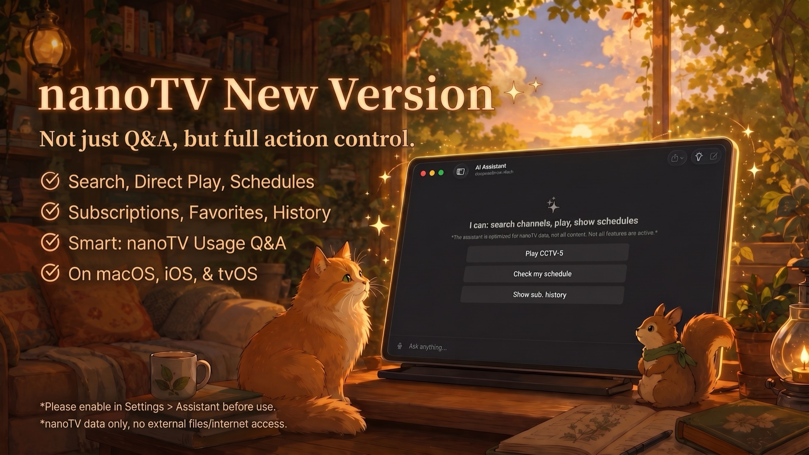
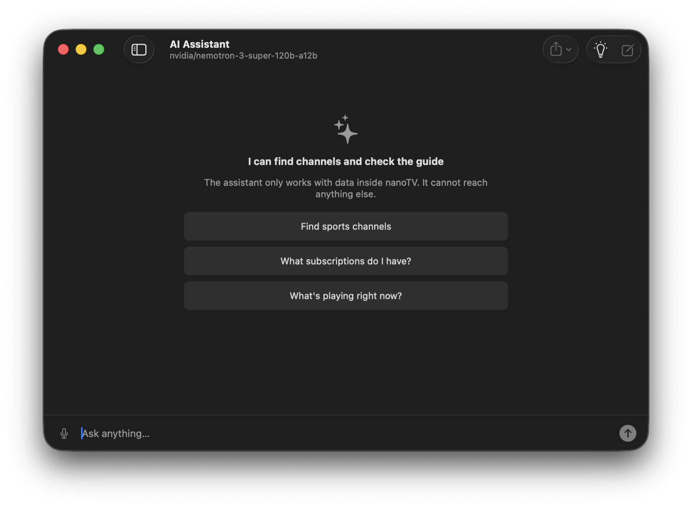
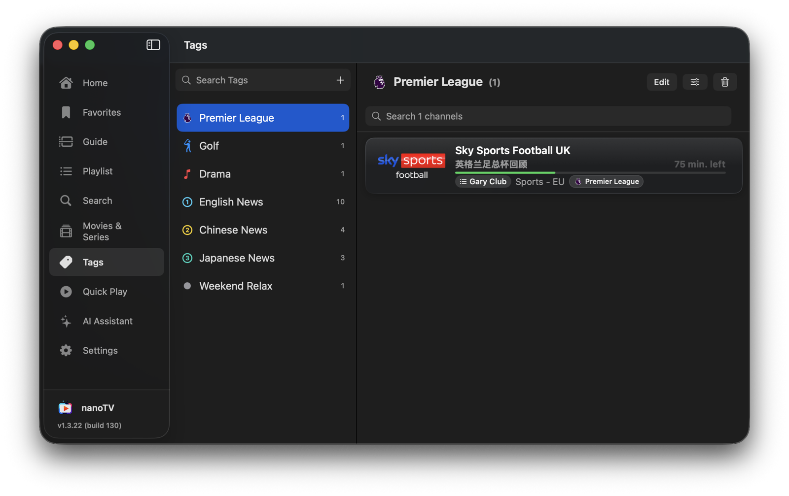

# nanoTV - Professional Media Player

  <a href="README.zh-CN.md">🇨🇳 简体中文</a>

  

  

**nanoTV** is a feature-rich, high-performance media player for **Mac, Apple TV, iPhone, and iPad**. An AI assistant that finds channels and takes action, cross-subscription channel tags, program reminders, AI real-time subtitles in English, Chinese and Japanese, multi-engine translation, 50p deinterlacing for live sports, and 4K/8K hardware-accelerated playback.

🌐 **Website**: [nanotv.app](https://nanotv.app)

---

## ✨ Features

### ✨ AI Assistant

Not just answers — the assistant carries out the action.

- **Find and play**: Search channels, start or stop playback, query the EPG for a match or a program, and create program reminders.
- **Manage subscriptions**: Add, edit, refresh or delete **M3U / Xtream Codes / Stalker Portal** subscriptions, quick-play a network stream and save it as a subscription.
- **Organize**: Manage favorites, recently played and channel tags; adapts to your habits through personalized memory.
- **Answers nanoTV questions**: subscriptions, AI subtitles, playback settings and Pro purchases.
- **Providers**: **Google Gemini**, **NVIDIA** (free tier), **Cloudflare** (free tier) and more, with a model connection test. Enable it in *Settings → Assistant*.

### 🏷 Channel Tags

Your categories, your rules — subscription groups no longer decide how you browse.

- **Cross-subscription**: One tag can gather channels from any subscription at the same time.
- **Many tags per channel**: The same channel can live in Premier League, Sports and 4K at once.
- **Colors & symbols**: 14 system colors plus “keep original”, 29 built-in symbols and official badges for the top five football leagues.
- **Order & sync**: Drag to reorder (move up/down on tvOS), rename or restyle anytime, synced across your devices through iCloud.

### 🎯 AI Subtitles & Translation
- **AI Real-time Subtitles**: Live transcription for **English, Chinese (Mandarin) and Japanese**, with real-time translation into your language. Subtitle size adapts to the player window, with a frosted-glass or feathered background for clean, readable text.
- **Multi-engine Translation**: Choose the engine that fits you — **Apple on-device translation** (macOS and iOS), **DeepL**, **large language models (LLM)**, **Google**, **Microsoft**, or your own self-hosted API.

### 🎞 Playback Engine
- **50p Deinterlacing**: YADIF 2x turns 1080i 25fps into smooth 50p — built for sports and live news.
- **Frame Rate & Dynamic Range Matching** *(Apple TV)*: Matches the output frame rate (25/50/60fps) and dynamic range (SDR/HDR/HLG) to the source.
- **Adjustable Live Buffer**: Balance stability against latency on IPTV streams.
- **Hardware Acceleration & Formats**: H.264/H.265 up to 4K and 8K, fast HLS start-up, MMTP/TLV streams, AV3A audio decoding, Dolby audio output (experimental on Apple TV) and refined SDR color rendering.

### 📺 Sources & Guide
- **Multi-format Subscriptions**: **M3U**, **Xtream Codes**, **Stalker Portal** and **TVHeadend**. Paste one or more plain URLs with **Text Import**, auto-refresh subscriptions at launch, and keep Xtream Codes groups in a sensible order.
- **Global Search**: Search channels and EPG programs across every subscription at once. Wrap a term in double quotes `""` for an exact match, and pick up where you left off with search history.
- **Electronic Program Guide (EPG)**: Zoom the guide grid in and out, browse posters and program categories, and refresh the EPG together with your subscriptions.
- **Subscription Sharing & Import**: Turn an M3U, Xtream Codes or Stalker Portal subscription into a QR code to share, and scan it on iPhone, iPad or Mac to add it in one step. nanoTV subscriptions can also be imported straight from Telegram, and the subscription name is optional.
- **Program Reminders**: Turn notifications on in *Settings → Program Guide*, then long-press a program that hasn't started yet in the guide to set a reminder — or just ask the AI assistant.
- **Remote Management & Network**: Add subscriptions from a computer or phone — including Xtream Codes, Stalker Portal and TVHeadend via QR code. SOCKS5 and HTTP proxies plus per-subscription User-Agent keep hard-to-reach sources playable.

### 🖥 Experience
- **Immersive Channel Preview** *(Apple TV)*: The home screen hero plays the current channel live, and the TV Guide previews any channel your cursor rests on. Muted by default; sound returns when you go full screen.
- **Favorites & History**: Start from a favorite and channel switching stays inside your favorites; recent channels are one swipe away.
- **Quick Play**: Paste a link and play it right away (<kbd>⌘N</kbd> on macOS), or submit a URL by QR code on Apple TV. Any quick-play entry can be saved as a subscription.
- **iCloud Sync**: Keep subscriptions and favorites in sync across Mac, iPhone, iPad and Apple TV, with a sync log that keeps the last 7 days.
- **Adaptive Layout & Multi-language UI**: Adaptive grids with a custom number of channel cards per row. Available in English, Simplified and Traditional Chinese, Japanese, Korean, French, Russian, Vietnamese, Arabic and more.

---

## 📥 Download

| Platform | Version | Link |
|----------|---------|------|
| **macOS** (Stable) | 1.3.21 | [Download on App Store](https://apps.apple.com/us/app/nanotv/id6754768796) |
| **iOS / iPadOS** (Stable) | 1.2.43 | [Download on App Store](https://apps.apple.com/us/app/nanotv/id6754768796) |
| **tvOS** (Stable) | 1.2.44 | [Download on App Store](https://apps.apple.com/us/app/nanotv/id6754768796) |
| **TestFlight** (Beta) | — | Temporarily unavailable |

---

## 📝 Release Notes

### Latest Release: macOS v1.3.21 · iOS v1.2.43 · tvOS v1.2.44

  

#### ✨ nanoTV Doesn't Just Play — It Starts to Understand You

The nanoTV AI assistant is here — and it doesn't only answer questions, it carries out the action. Ask it to find a channel and play it, look up tonight's match in the EPG, set a reminder, add or refresh a subscription, or tidy up your favorites and channel tags. Together with QR subscription sharing, program reminders and a smoother player, finding something to watch has never taken fewer steps.

  

- 🎬 **Take action** — search channels, start and stop playback, query the EPG, and quick-play a network stream then save it as a subscription.
- 🗂 **Manage everything** — add, edit, refresh or delete M3U / Xtream / Stalker subscriptions, plus favorites, recents and channel tags.
- 🧠 **Personal memory** — the assistant adapts to how you use nanoTV, and answers questions about subscriptions, AI subtitles, playback settings and Pro.
- 🔌 **More providers** — **Google Gemini**, **NVIDIA** (free tier) and **Cloudflare** (free tier) join the list, with a model connection test. Enable it in *Settings → Assistant*.

#### 🏷 Channel Tags — Your Categories, Your Rules

Subscription groups no longer decide how you browse. A single tag holds channels from any subscription, works across Mac, iPhone, iPad and Apple TV, and syncs through iCloud.

  

- 🌐 **Global, cross-subscription categories** — one tag can gather channels from different subscriptions at the same time.
- 🔖 **One channel, many tags** — the same channel can live in Premier League, Sports and 4K at once.
- 🎨 **Colors and symbols to match** — 14 system colors plus “keep original”, 29 built-in symbols and official badges for the top five football leagues.
- ↕️ **Order and batch edits** — drag to reorder (move up/down on tvOS), rename or restyle anytime, and sync it all through iCloud.

#### 🔗 Subscription Sharing & Program Reminders

- 📱 **QR sharing** — turn an M3U / Xtream Codes / Stalker Portal subscription into a QR code; iOS and macOS can scan it to add the subscription in one step.
- 💬 **Telegram import** — import a nanoTV subscription straight from Telegram. The subscription name is now optional when adding.
- ⏰ **Program reminders** — turn notifications on in *Settings → Program Guide*, then long-press a program that hasn't started yet in the guide to add a reminder.

#### 🖥️ macOS v1.3.21

- ✨ **AI Assistant** — search and play channels, query the EPG, set reminders and manage subscriptions, favorites and tags. Enable it in *Settings → Assistant*.
- 🏷 **Channel Tags** — cross-subscription tags with 14 colors, 29 symbols and league badges, drag-to-reorder and iCloud sync.
- 🔗 **QR Sharing & Reminders** — share M3U / Xtream / Stalker subscriptions as a QR code, import from Telegram, and set program reminders from the guide.
- 🎞 **Playback & Compatibility** — fixes for PPV and other special sources, frame-rate info in the playback bar, better M3U parsing, more extended group formats and embedded User-Agent support.
- 💬 **AI Subtitles** — fixed subtitle timing drift on some channels.

#### 📱 iOS v1.2.43 (iPhone & iPad)

- ✨ **AI Assistant** — find a channel and play it, look up programs, create reminders and manage your subscriptions by asking. Enable it in *Settings → Assistant*.
- 🏷 **Channel Tags** — build your own categories across subscriptions, synced to Mac and Apple TV via iCloud.
- 📷 **Scan to Subscribe** — scan a shared QR code to add a subscription, import from Telegram, and leave the subscription name blank if you like.
- 📂 **Open in Files** — long-press a media file in the **Files** app and play it straight in nanoTV.
- ⏰ **Program Reminders** — long-press a program that hasn't started in the guide, plus improved M3U parsing and embedded User-Agent support.

#### 📺 tvOS v1.2.44 (Apple TV)

- ✨ **AI Assistant** — ask for a channel, a match or a reminder right from the big screen. Enable it in *Settings → Assistant*.
- 🏷 **Channel Tags** — the same tags as on Mac and iPhone, reordered with move up / move down on tvOS.
- 🕹 **Smoother Guide Navigation** — a better scrolling feel in the guide's channel list, and scrolling past the last channel wraps back to the first.
- 💬 **Subtitles & Formats** — fixed AI subtitle timing on some channels, with better M3U parsing, more extended group formats and embedded User-Agent support.
- ⏰ **Program Reminders** — add reminders for programs that haven't started yet from the guide.

---

📋 Previous Releases

### macOS v1.3.20
- 🗣 **Chinese & Japanese AI Subtitles** — live transcription for Mandarin and Japanese, plus Japanese translation and larger, window-adaptive subtitle sizes.
- 🔎 **Zoomable Program Guide** — zoom the EPG grid in and out, with a smarter program-matching algorithm; the guide poster area adapts its height to the window.
- 🎨 **Better Picture & Sound** — refined SDR color rendering, AV3A audio decoding, improved M3U8 parsing and fixes for A/V clock drift on certain sources.
- ⚡ **Quick Play & Home** — name your quick-play channels, and see what's on now right on favorite channel cards.
- ☁️ **iCloud** — clearer sync log that keeps the last 7 days and cleans up automatically.

### iOS v1.2.42
- 🎞 **YADIF 2x Deinterlacing** — 1080i 25fps becomes smooth 50p output. Enable it in *Settings → Playback Settings → 1080i 50p*.
- 📶 **Live Buffer Control** — set your own live buffer to balance stability against latency, plus fixes for streams with mismatched A/V PTS.
- ⭐ **Favorites That Stay Put** — start from a favorite and channel switching stays inside your favorites; new favorites entries in the guide sidebar and player.
- 📡 **AirPlay & Layout** — more reliable AirPlay playback, adaptive search grids and custom card columns.

### tvOS v1.2.43
- 🗣 **Chinese & Japanese AI Subtitles** — live transcription for Mandarin, plus Japanese transcription and translation.
- 🔊 **Dolby Audio Output** *(experimental)* — plus AV3A decoding and fixes for A/V clock drift on certain sources.
- 🎨 **SDR Color Rendering** — more natural color and picture for SDR content, with improved M3U8 parsing.
- 📋 **EPG Improvements** — better program matching, no more blank guide entries, and EPG can refresh together with subscriptions.
- 🖼 **Immersive Previews** — the home screen hero and the TV Guide play the live channel, muted by default, with sound restored in full screen.

### tvOS v1.2.42
- 🖼 **Immersive Channel Preview** — live previews on the home screen hero and in the TV Guide, with separate toggles in *Settings → Playback*.
- 🎞 **Frame Rate & Dynamic Range Matching** — Apple TV matches output to 25/50/60fps and SDR/HDR/HLG.
- ⏱ **YADIF 2x & Live Buffer** — 1080i → 50p deinterlacing and configurable live buffering.
- ⭐ **Favorites & History** — favorites context is preserved when switching channels; swipe down in the player for recently watched channels.

### macOS v1.3.19
- 🎞 **YADIF 2x & Live Buffer** — 1080i 25fps → 50p output for sports and news, plus adjustable live buffering.
- ⭐ **Favorites Context** — channel switching stays within favorites, with new entries in the guide sidebar and player.
- 🪟 **Frosted-Glass Subtitles** — new subtitle background with more depth and clearer edges.
- 🔄 **Xtream Codes Group Order** — refresh an existing subscription once to apply the new sorting.

### iOS v1.2.41
- 🎞 **YADIF 2x & Live Buffer** — smoother sports playback and configurable live buffering.
- 📡 **AirPlay** — improved playback stability.
- 🔄 **Xtream Codes Group Order** — refresh an existing subscription once to apply the improved group sorting.

### macOS v1.3.18
- 🌐 **DeepL & LLM Translation** — configure them in *Settings → Subtitles & Translation*.
- ⏩ **VOD Progress Bar** — scrub, fast-forward and rewind on-demand programs.
- 🎛 **Adaptive Grids** — set how many channel cards appear per row in subscription and favorites lists.
- 📥 **Text Import** — paste one or more plain URLs to add subscriptions in one step.

### tvOS v1.2.41
- 🌐 **DeepL & LLM Translation** — plus improved TTML subtitle parsing and display.
- 📱 **QR Code Remote Add** — scan to submit a playback URL, or add XC, Stalker Portal and TVHeadend subscriptions.
- ▶️ **Single-Click Play** — channels in the guide now play on a single click, with live program info in the top bar.

### iOS v1.2.40
- 🌐 **DeepL & LLM Translation** — configure them in *Settings → Subtitles & Translation*.
- ⚡ **Quick Play** — a new entry at the top of the home screen and in Settings, plus a VOD progress bar.
- 📥 **Text Import** — paste one or more plain URLs to add subscriptions in one step.

### macOS v1.3.17
- 🔍 **Cross-Subscription Search** — search channels and EPG programs across every subscription.
- ⚡ **Fast HLS Start-up** — enable it in Settings, and enjoy wider decoding compatibility including MMTP/TLV.
- 🔒 **SOCKS5 Proxy** — new SOCKS5 support alongside HTTP proxy.
- 🪟 **Subtitle Backgrounds** — frosted and feathered (dark cloud) subtitle backgrounds.

### iOS v1.2.38 – v1.2.39
- 🔍 **Cross-Subscription Search** — channels and EPG, with exact match via double quotes.
- 🔄 **Auto-Refresh & SOCKS5** — refresh subscriptions on launch, refresh EPG manually, and connect through SOCKS5.
- ⚡ **Fast HLS Start-up** — quicker playback start on HLS streams.

### tvOS v1.2.40
- 🔍 **Cross-Subscription Search** — channels and EPG, with exact match via double quotes.
- ⚡ **Fast HLS Start-up & SOCKS5** — quicker playback start, MMTP/TLV support and SOCKS5 proxy.
- 🪟 **Subtitle Backgrounds** — new frosted and feathered (dark cloud) subtitle backgrounds.

### macOS v1.3.13 · iOS v1.2.36 · tvOS v1.2.35
- 🔄 **Custom Subscription Ordering** — enter edit mode and drag to reorder your subscriptions.
- 🔍 **Full-Channel Search** — fuzzy matching, or wrap your term in double quotes `""` for an exact match.
- ✨ **Redesigned tvOS UI** — immersive visuals built for the big screen, with smoother navigation and a performance boost.
- ⭐ **macOS Player Controls** — added favorite and mute buttons to the playback view.

### macOS v1.3.6 · iOS v1.2.28 · tvOS v1.2.29
- 📡 **Stalker Portal Subscriptions** — add your sources via Stalker Portal.
- 📋 **EPG Download Optimization** — handles incorrect EPG file extensions.
- 🎬 **Smoother Playback** — reduced video stuttering on macOS.

### macOS v1.3.4 · iOS v1.2.26
- 🌐 **Apple Native Translation** — blazing-fast on-device subtitle translation, no internet needed. Requires iOS 18.0+.
- 📋 **EPG Window Optimization** — improved program guide browsing experience (iOS).

### macOS v1.3.3 · iOS v1.2.25 · tvOS v1.3.3
- 🔄 **iCloud Sync** — seamlessly sync subscriptions & favorites across macOS, iOS and tvOS.
- 📋 **EPG Dedicated Tab** *(iOS 18+)* — one-stop program browsing with direct channel switching, plus English ↔ Chinese EPG translation.
- ⛶ **Seamless Full-Screen** — switch channels without exiting full screen.
- 🔤 **Subtitle Font Size** — adjustable in *Settings → Playback Settings*.
- 🖼 **Home Screen Poster** *(tvOS)* — channel posters on the home screen, configurable in Settings.
- 📐 **Aspect Ratio Settings** — control video aspect ratio for any content.
- ⌨️ **Keyboard Shortcuts** *(macOS)* — full shortcut support for an efficient desktop workflow.

---

## 📖 Guides & FAQ

- [**macOS Help Document**](macOS_help.md) — quick start, AI subtitles, playback settings and keyboard shortcuts.
- [**FAQ**](FAQ.md) — real-time subtitles, translation engines, deinterlacing, buffering, EPG and more.
- [**Platform Guide (macOS / iOS / tvOS)**](https://nanotv.app/support.html) — full control and operation guide for every platform.

---

## 💬 Feedback & Support

👉 **Telegram Community**: [https://t.me/nanotvinfo](https://t.me/nanotvinfo)

We ship updates frequently and read every piece of feedback — many of the features above started as a user request in our Telegram channel.
