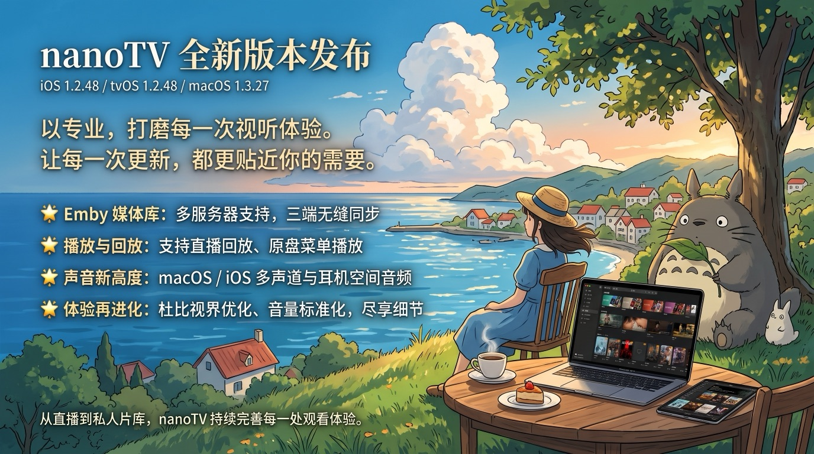

# nanoTV - 专业媒体播放器

  <a href="README.md">🇺🇸 English</a>

  

  

**nanoTV** 是一款功能丰富、性能强大的 **Mac、Apple TV、iPhone 和 iPad** 媒体播放应用。**Emby 媒体库**与 **Xtream 点播**让直播、私人片库、电影与剧集汇聚一处，支持**直播回放**、**4K 蓝光原盘**、**杜比视界**，以及耳机**空间音频与头部追踪**，AI 助手帮你找节目、开播放，频道标签跨订阅自由分类，支持英文、中文、日文 AI 实时字幕与多引擎翻译，50p 反交错让体育直播更流畅，4K/8K 硬件加速播放。

🌐 **官网**: [nanotv.app](https://nanotv.app)

---

## ✨ 核心功能

### 📚 Emby 媒体库

- **多服务器**：支持添加多个 Emby 服务器，浏览与播放媒体库资源，并支持 .strm 资源播放。
- **三端同步**：播放进度、收藏及最近播放记录在 Mac、iPhone、iPad 和 Apple TV 之间同步。
- **剧集连播**：自动播放下一集，也可手动切换上一集 / 下一集。
- **字幕**：支持内嵌字幕、Emby 服务端字幕及在线字幕搜索。

### 🎬 Xtream 点播：电影与剧集

直播、电影与剧集汇聚于同一平台。使用前请在「设置 → 点播」中开启。

- **海报墙与热门**：自动刮削 Xtream 点播元数据生成海报墙，并展示一周内 TMDB 热门电影和剧集、自动匹配已有点播资源。
- **筛选与搜索**：按类型、年份、国家地区、语言快速筛选；按片名、导演、演员搜索。
- **多端同步**：播放进度、收藏与标签通过 iCloud 在 Mac、iPhone、iPad 和 Apple TV 之间同步，并支持 Trakt 观看记录同步。
- **离线观看**：电影和剧集离线后无需网络即可观看。
- **字幕**：在线搜索 OpenSubtitles、SubDL、SubSource 字幕，加载本地字幕文件，或使用 AI 字幕转录与翻译。

### ✨ AI 助手

不只是回答问题，更能直接帮你完成操作。

- **找台与播放**：搜索频道、直接播放或退出播放、查询 EPG 节目单中的比赛与节目，并创建节目提醒。
- **管理订阅**：添加、修改、刷新、删除 **M3U / Xtream Codes / Stalker Portal** 订阅，快捷播放网络流并将历史记录保存为订阅。
- **整理内容**：管理收藏、最近播放与频道标签，并通过个性化记忆逐步适应你的使用习惯。
- **解答使用问题**：订阅、AI 字幕、播放设置、Pro 购买等 nanoTV 使用问题。
- **模型服务商**：支持 **Google Gemini**、**NVIDIA**（支持免费）、**Cloudflare**（支持免费）等，并提供模型连接测试。使用前请前往「设置 → 助手」开启并配置大模型。

### 🏷 频道标签

你的分类，你说了算——不再受订阅分组摆布。

- **跨订阅分类**：一个标签可以同时包含来自不同订阅的频道。
- **一个频道，多个标签**：同一个频道可以同时属于「英超」「体育」「4K」。
- **颜色与图标**：14 种系统配色 +「保留原色」，29 个内置符号以及五大联赛官方图标。
- **排序与同步**：标签可拖拽排序（tvOS 用上移/下移），随时重命名或改外观，并通过 iCloud 在设备之间同步。

### 🎯 AI 字幕与翻译
- **AI 实时字幕**：支持**英文、中文（普通话）和日文**实时转录，并可实时翻译为您需要的语言。字幕字号随播放窗口自适应，配合磨砂玻璃与羽化背景效果，画面更干净、字幕更清晰。
- **ASS 特效字幕**：支持 ASS 字幕的样式与特效。
- **多引擎字幕翻译**：按需选择翻译引擎——**Apple 原生本地翻译**（macOS 和 iOS）、**DeepL**、**大模型（LLM）翻译**、**Google**、**Microsoft**，以及自托管的自定义接口。

### 🎞 专业播放引擎
- **直播回放与倍速**：支持直播频道回放（Catchup）；点播内容支持倍速播放。
- **蓝光与 DVD 原盘**：支持通过 WebDAV / Emby 播放 4K 蓝光及 DVD 原盘 ISO，并支持原盘导航菜单。
- **杜比视界**：三端支持 Profile 5、8.1、8.4，兼容 MKV / MP4 / HLS；Apple TV 播放时可自动切换电视至杜比视界模式；蓝光原盘双层杜比视界（Profile 7）以 HDR10 播放。
- **50p 反交错**：YADIF 2x 可将 1080i 25fps 隔行画面转换为 50p 双倍帧率输出，专为体育赛事和新闻直播优化，并优化 1080i 隔行视频的单帧显示效果。
- **匹配帧率与动态范围** *(Apple TV)*：自动匹配片源的输出帧率（25/50/60fps）与动态范围（SDR/HDR/HLG）。
- **直播缓冲调节**：可自定义 IPTV 直播缓冲时间，在流畅与低延迟之间自由平衡。
- **硬件加速与格式支持**：H.264/H.265 硬件加速解码，支持 4K、8K 播放；HLS 视频流快速启播、MMTP/TLV 流、AV3A 音频解码、杜比音频输出（Apple TV 实验功能），并优化 SDR 色彩渲染。

### 🎧 音频体验
- **多声道与空间音频** *(macOS、iOS)*：支持多声道输出，耳机支持空间音频与头部追踪。
- **高音质音轨**：自动选择高音质音轨。
- **音量标准化**：自动平衡不同频道与节目之间的响度。

### 📺 订阅与节目单
- **多格式订阅**：支持 **M3U**、**Xtream Codes**、**Stalker Portal** 和 **TVHeadend**。可通过「文本导入」一次粘贴一个或多个纯网址，支持启动时自动刷新订阅，并优化 Xtream Codes 分组排序。
- **全局搜索**：支持跨所有订阅同时搜索频道和 EPG 节目。搜索词加双引号 `""` 即可精确查询，并提供搜索历史记录。
- **电子节目指南（EPG）**：节目单网格支持自由缩放，提供节目海报与分类信息展示，并支持在刷新订阅时同步更新 EPG。EPG 翻译可自动识别源语言，并翻译为你设置的目标语言。
- **订阅分享与导入**：可将 M3U、Xtream Codes 与 Stalker Portal 订阅生成二维码分享，iOS 与 macOS 扫码即可一步添加；同时支持从 Telegram 一键导入 nanoTV 订阅，添加订阅时的名称也改为可选项。
- **节目提醒**：在「设置 → 节目单」中开启通知后，在节目单界面长按尚未开始的节目即可添加提醒，也可以直接让 AI 助手帮你创建。
- **远程管理与网络**：支持通过电脑或手机远程添加订阅，扫码添加已支持 Xtream Codes、Stalker Portal 和 TVHeadend。内置 SOCKS5 与 HTTP 代理，并支持订阅级 User-Agent，让更多播放源顺利可用。

### 🖥 使用体验
- **沉浸式频道预览** *(Apple TV)*：首页 Hero 区域实时播放当前频道画面，TV Guide 中光标停留即可预览直播。预览默认静音，进入全屏播放后自动恢复声音。
- **收藏与播放历史**：从收藏频道开始播放后，后续频道列表和换台操作自动保持在收藏范围内；最近观看的频道也能快速取回。收藏的直播频道与电影剧集支持排序，每个频道还会记住字幕开关与翻译语言。
- **多窗口播放** *(macOS)*：同时观看多路节目，声音跟随当前播放窗口，并支持多窗口同时开启 AI 字幕。
- **快速播放**：输入链接即可立即播放（macOS 快捷键 <kbd>⌘N</kbd>），Apple TV 支持远程扫码提交播放地址。快速播放的历史记录还能一键添加为订阅，并支持加载外挂字幕。
- **iCloud 多端同步**：在 Mac、iPhone、iPad 和 Apple TV 之间同步订阅、收藏、频道标签与点播播放进度，同步日志清晰可查并自动保留最近 7 天记录。
- **自适应布局与多语言界面**：支持自适应网格布局与自定义每行卡片数量。界面支持英文、简体中文、繁体中文、日语、韩语、法语、俄语、越南语、阿拉伯语等多种语言。

---

## 📥 下载

| 平台 | 版本 | 链接 |
|------|------|------|
| **macOS**（稳定版） | 1.3.27 | [在 App Store 下载](https://apps.apple.com/us/app/nanotv/id6754768796) |
| **iOS / iPadOS**（稳定版） | 1.2.48 | [在 App Store 下载](https://apps.apple.com/us/app/nanotv/id6754768796) |
| **tvOS**（稳定版） | 1.2.48 | [在 App Store 下载](https://apps.apple.com/us/app/nanotv/id6754768796) |
| **TestFlight**（测试版） | — | 暂停开放 |

---

## 📝 更新日志

### 最新版本：macOS v1.3.27 · iOS v1.2.48 · tvOS v1.2.48

  

#### 🚀 从直播到私人片库

以专业打磨体验，让每一次更新，都更贴近你的观看需要。本次更新带来 Emby 媒体库、直播频道回放与更丰富的原盘播放能力；macOS / iOS 新增多声道输出，支持耳机空间音频与头部追踪。

#### 📚 Emby 媒体库

- 🗄 支持添加**多个 Emby 服务器**，浏览与播放媒体库资源。
- ☁️ 支持**三端同步**播放进度、收藏及最近播放记录。
- 📄 支持 **.strm** 资源播放。
- ⏭ 剧集支持**自动播放下一集**，以及手动切换上一集 / 下一集。
- 💬 支持内嵌字幕、Emby 服务端字幕及在线字幕搜索。

#### ⏪ 播放与回放

- 📺 支持**直播频道回放（Catchup）**。
- ⏩ 支持点播**倍速播放**。
- 💿 支持通过 WebDAV / Emby 播放 **4K 蓝光及 DVD 原盘 ISO**，并支持原盘导航菜单。
- 🔆 三端支持**杜比视界 P5、P8.1、P8.4**（MKV / MP4 / HLS）；蓝光原盘 P7 双层格式以 HDR10 播放。
- 🎨 支持 **ASS 特效字幕**。
- ⚡ 快捷播放支持外挂字幕。

#### 🎧 音频体验

- 🎧 macOS / iOS 新增**多声道输出**，支持耳机**空间音频与头部追踪**。
- 🎼 支持自动选择高音质音轨。
- 🔊 新增**音量标准化**，自动平衡不同频道与节目之间的响度。

#### 🛠 优化与修复

- 优化设置界面布局及 iOS 播放界面。
- 优化杜比视界播放效果。
- 优化 1080i 隔行视频的单帧显示效果。
- 修复 iOS 长按频道卡片时意外起播的问题。
- 优化 tvOS 频道封面及 iOS 锁屏封面中的台标显示。
- 优化 HTTP 401、502 等错误的重试处理。
- 优化 iCloud 同步，修复特定情况下新订阅被旧订阅覆盖的问题。

---

### macOS v1.3.26 · iOS v1.2.47 · tvOS v1.2.47 —— 杜比视界

#### 🎬 杜比视界，让精彩更出彩

- 🌈 支持**杜比视界 Profile 5、8.1、8.4**，兼容 **MKV / MP4 / HLS**。
- 🖥 在支持杜比视界的 Mac、iPhone、iPad 和 Apple TV 及相应显示设备上，呈现更丰富的色彩与明暗细节。
- 📺 **Apple TV** 播放时可自动切换电视至杜比视界模式。
- 💿 蓝光原盘双层杜比视界（**Profile 7**）以 HDR10 播放。

#### 本次其它更新

- 💬 **每个频道，都记得你的偏好**——自动记住各频道的字幕开关与翻译语言，再次播放时沿用你的设置，省去重复调整。
- 🔎 **点播筛选更顺手**——优化点播筛选体验，找片更方便。
- 🌐 **修复微软翻译服务**——修复 Microsoft 翻译服务相关问题。

---

📋 历史版本

### macOS v1.3.25 · iOS v1.2.46 · tvOS v1.2.46 —— Xtream 点播

#### 🎬 从 Live 到 VOD，nanoTV 迎来全新跨越

Xtream 点播让直播、电影与剧集汇聚于同一平台，在 iPhone、Apple TV 和 Mac 上构建完整、统一的影音体验。使用前请在「设置 → 点播」中开启。

- 🖼 **海报墙**——自动刮削 Xtream 点播元数据，显示中文电影剧集海报墙。
- 🔥 **热门电影和剧集**——显示一周内 TMDB 热门电影和剧集，自动匹配已有的 Xtream 点播资源。
- ⏯ **播放记忆**——记住电影和剧集进度，并支持 iCloud 三端同步。
- 🔄 **Trakt**——支持 Trakt 观看记录同步。
- 📥 **离线观看**——电影和剧集离线后无需网络即可观看。
- 💬 **字幕**——在线搜索字幕（OpenSubtitles、SubDL、SubSource），加载本地字幕文件，以及 AI 字幕转录和翻译。
- 🔎 **筛选与搜索**——按类型、年份、国家地区、语言快速筛选；按电影名称、导演、演员搜索，并支持全局搜索。
- ⭐ **收藏与标签**——电影剧集支持收藏与标签管理，并通过 iCloud 同步。

#### 其它新增和优化

- 🪟 **多窗口播放**（macOS）——在「设置 → 播放 → 总是在新窗口播放」中开启；声音跟随当前播放窗口，支持多窗口同时开启 AI 字幕。
- ↕️ **收藏排序**——支持直播频道和电影剧集排序。
- 🌐 **EPG 翻译优化**——自动适配 EPG 源语言，并可设置目标语言。
- 🎞 **帧率显示优化**（macOS、iOS）——60fps、25fps 实际播放不掉帧。
- 🎨 **iOS 界面优化**——频道列表减少横向线条；浅色模式界面优化，适配浅色模式台标。
- 🛠 **问题修复**——tvOS 搜索历史显示问题、tvOS 27 全局搜索页面频道播放问题，以及 iOS 键盘特定情况下的显示问题。

### macOS v1.3.21
- ✨ **AI 助手**——搜索并播放频道、查询 EPG 节目单、创建提醒，并管理订阅、收藏与标签。请在「设置 → 助手」中开启并配置大模型。
- 🏷 **频道标签**——跨订阅标签分类，14 种配色、29 个符号与五大联赛图标，支持拖拽排序与 iCloud 同步。
- 🔗 **二维码分享与节目提醒**——M3U / Xtream / Stalker 订阅可生成二维码分享，支持从 Telegram 导入，并可在节目单中添加节目提醒。
- 🎞 **播放与兼容性**——修复部分 PPV 等特殊视频源播放问题，播放信息栏新增帧率信息，优化 M3U 解析，支持更多扩展分组格式与内嵌 User-Agent。
- 💬 **AI 字幕**——修复部分频道 AI 字幕显示不同步问题。

### iOS v1.2.43（iPhone & iPad）
- ✨ **AI 助手**——一句话找频道并播放、查询节目、创建提醒并管理订阅。请在「设置 → 助手」中开启并配置大模型。
- 🏷 **频道标签**——跨订阅自建分类，并通过 iCloud 与 Mac、Apple TV 同步。
- 📷 **扫码添加订阅**——扫描分享的二维码即可添加订阅，支持从 Telegram 导入，订阅名称也改为可选项。
- 📂 **从「文件」App 打开**——在「文件」App 中长按媒体文件，即可直接使用 nanoTV 打开播放。
- ⏰ **节目提醒**——在节目单中长按尚未开始的节目即可添加提醒，同时优化 M3U 解析并支持内嵌 User-Agent 扩展格式。

### tvOS v1.2.44（Apple TV）
- ✨ **AI 助手**——在大屏上直接问频道、找比赛、建提醒。请在「设置 → 助手」中开启并配置大模型。
- 🏷 **频道标签**——与 Mac、iPhone 共享同一套标签，tvOS 上通过上移 / 下移调整顺序。
- 🕹 **节目单操作优化**——优化节目单频道列表滑动体验，滑动到最后一个频道后继续向下，可快速返回第一个频道。
- 💬 **字幕与格式兼容**——修复部分频道 AI 字幕显示不同步问题，优化 M3U 解析，支持更多扩展分组格式与内嵌 User-Agent。
- ⏰ **节目提醒**——支持在节目单中为尚未开始的节目添加提醒。

### macOS v1.3.20
- 🗣 **中文与日文 AI 字幕**——新增中文（普通话）实时转录、日文实时转录与翻译，字幕字号更大并随窗口自适应。
- 🔎 **节目单缩放**——支持自由 Zoom In / Zoom Out 查看不同时间范围与频道，优化 EPG 查询与节目匹配算法，海报区域高度随窗口自适应。
- 🎨 **画质与音频提升**——优化 SDR 色彩渲染，新增 AV3A 音频解码，优化 M3U8 解析以兼容更多播放源，并改善特定播放源的音视频时钟不同步问题。
- ⚡ **快捷播放与首页**——快捷播放新增频道名称输入，首页收藏频道卡片显示当前正在播放的节目信息。
- ☁️ **iCloud**——优化同步日志显示，保留最近 7 天记录并自动清理过期内容。

### iOS v1.2.42
- 🎞 **YADIF 2x 反交错**——将 1080i 25fps 隔行视频转换为 50p 双倍帧率输出，可在「设置 → 播放设置 → 1080i 50p 反交错」开启。
- 📶 **直播缓冲调节**——可自定义直播缓冲时间，在稳定性与直播延迟之间自由平衡，并修复部分视频源音视频 PTS 不一致的问题。
- ⭐ **收藏语境保持**——从收藏频道进入播放后，频道列表与换台自动保持在收藏范围内；节目单侧边栏和播放窗口新增收藏入口。
- 📡 **AirPlay 与布局**——提升 AirPlay 播放稳定性，全局搜索支持自适应网格与自定义卡片列数。

### tvOS v1.2.43
- 🗣 **中文与日文 AI 字幕**——新增中文（普通话）实时转录，以及日文实时转录与翻译。
- 🔊 **杜比音频输出**（实验功能）——同时新增 AV3A 音频解码，并优化特定播放源的音视频时钟不同步问题。
- 🎨 **SDR 画质优化**——改善 SDR 视频的色彩与画面表现，观感更自然，并优化 M3U8 解析。
- 📋 **节目单优化**——优化 EPG 查询与匹配算法，修复节目单空白内容问题，并支持刷新订阅时同步更新 EPG。
- 🖼 **沉浸式预览**——首页 Hero 与 TV Guide 实时播放直播画面，默认静音，进入全屏后自动恢复声音。

### tvOS v1.2.42
- 🖼 **沉浸式频道预览**——首页 Hero 与 TV Guide 均可实时预览直播，可在「设置 → 播放设置」中分别开关。
- 🎞 **匹配帧率与动态范围**——Apple TV 自动匹配 25/50/60fps 帧率与 SDR/HDR/HLG 动态范围输出。
- ⏱ **YADIF 2x 与直播缓冲**——支持 1080i → 50p 反交错，并可配置直播缓冲时间。
- ⭐ **收藏与播放历史**——换台保持收藏语境；播放窗口下滑即可显示最近播放的频道卡片。

### macOS v1.3.19
- 🎞 **YADIF 2x 与直播缓冲**——1080i 25fps 转 50p 输出，优化体育与新闻画面流畅度，并支持自定义直播缓冲时间。
- ⭐ **收藏语境保持**——换台自动保持在收藏范围内，节目单侧边栏与播放窗口新增收藏入口。
- 🪟 **磨砂玻璃字幕**——全新字幕背景效果，边界与层次感更清晰。
- 🔄 **XC 分组排序优化**——已存在订阅刷新一次即可应用新排序。

### iOS v1.2.41
- 🎞 **YADIF 2x 与直播缓冲**——体育赛事画面更流畅，并支持配置直播缓冲时间。
- 📡 **AirPlay 优化**——提升 AirPlay 播放稳定性。
- 🔄 **XC 分组排序优化**——已存在的订阅刷新一次即可应用新的分组排序。

### macOS v1.3.18
- 🌐 **DeepL 与大模型翻译**——可在「设置 → 字幕和翻译」中配置。
- ⏩ **点播进度条**——点播节目支持快进、快退和拖动定位。
- 🎛 **自适应网格**——订阅与收藏列表支持自定义每行显示的频道卡片数量。
- 📥 **文本导入**——添加订阅时可直接粘贴一个或多个纯网址，一步完成添加。

### tvOS v1.2.41
- 🌐 **DeepL 与大模型翻译**——同时优化 TTML 字幕解析与显示效果。
- 📱 **远程扫码添加**——扫码即可提交播放地址，并支持添加 XC、Stalker Portal 和 TVHeadend 订阅。
- ▶️ **单击播放**——节目单中频道由双击改为单击播放，顶部栏实时更新当前节目信息。

### iOS v1.2.40
- 🌐 **DeepL 与大模型翻译**——可在「设置 → 字幕和翻译」中配置。
- ⚡ **快速播放**——首页顶部左侧与设置页面新增入口，点播节目同时新增播放进度条。
- 📥 **文本导入**——添加订阅时可直接粘贴一个或多个纯网址，一步完成添加。

### macOS v1.3.17
- 🔍 **跨订阅搜索**——支持跨所有订阅搜索频道与 EPG 节目。
- ⚡ **HLS 快速启播**——可在设置中开启，同时增强解码兼容性并支持 MMTP/TLV 等更多流格式。
- 🔒 **SOCKS5 代理**——在 HTTP 代理之外新增 SOCKS5 代理支持。
- 🪟 **字幕背景效果**——新增磨砂与羽化（暗云）字幕背景效果。

### iOS v1.2.38 – v1.2.39
- 🔍 **跨订阅搜索**——支持搜索频道与 EPG 节目，双引号包裹即可精确查询。
- 🔄 **自动刷新与 SOCKS5**——支持打开 App 时自动刷新订阅、手动刷新 EPG，并新增 SOCKS5 代理支持。
- ⚡ **HLS 快速启播**——HLS 流启播更快。

### tvOS v1.2.40
- 🔍 **跨订阅搜索**——支持搜索频道与 EPG 节目，双引号包裹即可精确查询。
- ⚡ **HLS 快速启播与 SOCKS5**——启播更快，支持 MMTP/TLV 流格式，并新增 SOCKS5 代理。
- 🪟 **字幕背景效果**——新增磨砂与羽化（暗云）字幕背景效果。

### macOS v1.3.13 · iOS v1.2.36 · tvOS v1.2.35
- 🔄 **订阅自定义排序**——进入编辑模式后，支持拖拽调整订阅顺序。
- 🔍 **全频道搜索**——支持模糊查询，在搜索词前后加双引号 `""` 即可精确查询。
- ✨ **tvOS 全新界面与交互**——专为 tvOS 优化设计的沉浸式视觉与交互，大屏操作更流畅，性能提升、减少卡顿。
- ⭐ **macOS 播放界面优化**——播放界面增加收藏按钮和声音开关按钮。

### macOS v1.3.6 · iOS v1.2.28 · tvOS v1.2.29
- 📡 **Stalker Portal 订阅**——新增支持 Stalker Portal 订阅源。
- 📋 **EPG 下载优化**——适配 EPG 文件后缀错误的情况。
- 🎬 **播放更流畅**——减少 macOS 视频播放卡顿。

### macOS v1.3.4 · iOS v1.2.26
- 🌐 **Apple 原生翻译**——极速本地字幕翻译，无需联网。需要 iOS 18.0 或以上。
- 📋 **EPG 节目单窗口优化**——提升节目单浏览体验（iOS）。

### macOS v1.3.3 · iOS v1.2.25 · tvOS v1.3.3
- 🔄 **iCloud 多端同步**——在 macOS、iOS、tvOS 间无缝同步订阅和收藏。
- 📋 **独立 EPG 标签**（iOS 18+）——一站式节目浏览，支持直接切台播放，并支持英中双语节目单实时翻译。
- ⛶ **全屏无缝切台**——不退出全屏即可直接切换频道。
- 🔤 **字幕字体大小**——可在「设置 → 播放设置」中调整。
- 🖼 **首页海报显示** *(tvOS)*——主屏幕显示频道海报，可在设置中配置。
- 📐 **画面比例设置**——支持自定义视频画面比例。
- ⌨️ **完整快捷键支持** *(macOS)*——高效的桌面操作体验。

---

## 📖 使用指南与常见问题

- [**macOS 帮助文档**](macOS_help.zh-CN.md)——快速入门、AI 字幕、播放设置与键盘快捷键。
- [**常见问题（FAQ）**](FAQ.zh-CN.md)——实时字幕、翻译引擎、反交错、直播缓冲、EPG 等问题解答。
- [**各平台使用指南（macOS / iOS / tvOS）**](https://nanotv.app/support.html)——各平台完整的控制与操作说明。

---

## 💬 反馈与支持

👉 **Telegram 社区**: [https://t.me/nanotvinfo](https://t.me/nanotvinfo)

我们保持高频更新，并认真对待每一条反馈——上面的许多功能，最初都来自 Telegram 频道中用户的建议。
